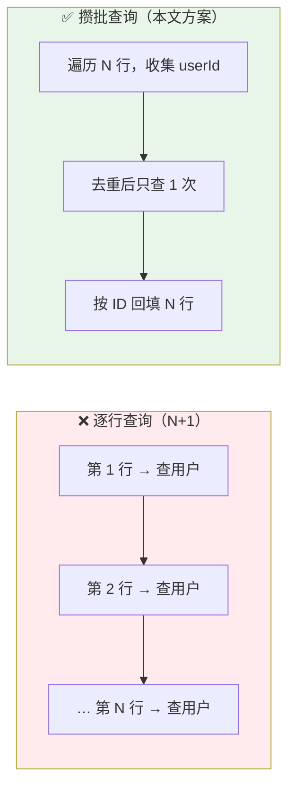
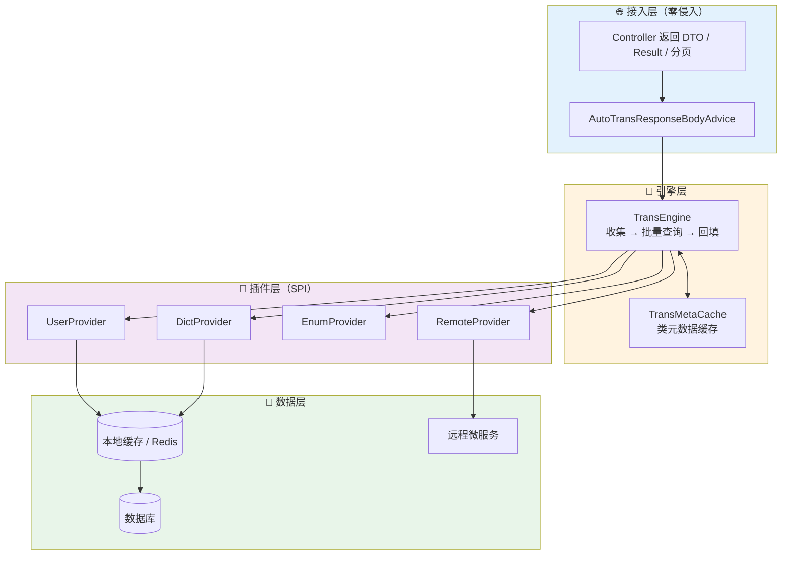
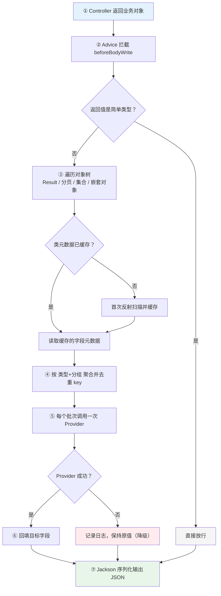
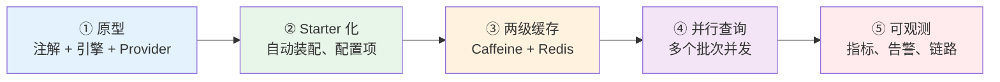

> 接口只返回 ID、前端却要展示名称时，最优雅的做法是在 DTO 字段上加一个 `@AutoTrans` 注解，让框架在响应序列化之前统一完成"收集 ID → 去重批量查询 → 回填名称"，既不用 SQL 联表，也不用手写回填，还能根治 N+1 查询。本文从零实现一套**通用、零业务侵入、高性能**的数据翻译框架，覆盖外键 ID、字典码、枚举、多值 ID、跨服务调用等场景，并给出经本地编译运行验证的 Java 代码与生产避坑清单。
>
> 📌 **适合人群**：后端开发者、正在做中后台/微服务接口的 Spring Boot 使用者，以及想理解"批量聚合 + SPI 扩展"设计思路的读者
>
> 📌 **技术栈**：Java 17+，Spring Boot 2.7 / 3.x 及更新版本（核心只依赖 Spring MVC 的 `ResponseBodyAdvice` 扩展点）


<VideoPlayer
src="//cdn.smallyoung.cn/smallyoung_blog/springboot-data-trans/构建零侵入的数据翻译框架.mp4"
/>

<MindMapFloat title="数据翻译框架知识图谱">

```mindmap-data
# 通用数据翻译框架
## 为什么需要
- 数据库只存 ID，前端要展示名称
- SQL JOIN 破坏表自治、拖重分页与 COUNT
- 手写回填 = 样板代码 + N+1 风险
## 设计思想
- 零侵入：注解 + ResponseBodyAdvice
- 攒批：收集 → 去重 → 批量查询 → 回填
- SPI：新增维度只加一个 Provider
- 元数据缓存：反射只扫描一次
## 运作机制
- 遍历对象树（Result / 分页 / 集合 / 嵌套）
- 批次 = 翻译类型 + 分组
- key 按字符串归一，兼容 Long / Integer
- 失败降级：保持原值
## 场景覆盖
- 外键 ID、字典码、枚举
- 多值 "1,2,3"
- 跨服务 RPC
- 非 HTTP 出口（导出 / MQ）
## 生产实践
- Caffeine 批量缓存 + 分片
- Provider 内必须批量查询
- 避坑：record、共享缓存对象、懒加载实体、WebFlux
```

</MindMapFloat>

## 关于本文档

本文以"订单列表里只有 userId、deptId、状态码，前端却要展示姓名、部门名、状态文案"这个最常见的场景为主线，带你从痛点出发，一步步设计并实现一套可以直接落地的通用数据翻译框架。你读完不仅能照着接入，还能把它扩展到字典、枚举、跨服务等更多场景。

- ✅ 数据翻译要解决什么问题，传统四种做法各有什么代价
- ✅ 框架的五条设计准则与四层架构
- ✅ 注解、SPI、元数据缓存、批处理引擎、响应拦截器的完整 Java 实现
- ✅ 一套框架覆盖外键、字典、枚举、多值 ID、跨服务、非 HTTP 出口六类场景
- ✅ 与 Jackson 序列化器、开源 easy-trans 的横向对比，以及生产环境的避坑清单

## 1. 为什么接口返回的 ID 总要"翻译"？

### 1.1 一个再普通不过的订单列表

在前后端分离的系统里，数据库表通常按范式设计，订单表只保存关联对象的主键。你可以把数据库想象成一本"身份证号花名册"：每一行只写着号码，而用户界面需要的却是"张三"这样的名字。于是接口需要把号码"翻译"成人能读懂的文字。

翻译前，数据库里取出来的是这样：

```json
{
  "orderId": "ORD20261015001",
  "userId": 10001,
  "deptId": 20002,
  "statusCode": "PAID"
}
```

翻译后，前端想要的是这样：

```json
{
  "orderId": "ORD20261015001",
  "userId": 10001,
  "userName": "张三",
  "deptId": 20002,
  "deptName": "研发中心",
  "statusCode": "PAID",
  "statusName": "已支付"
}
```

这类需求几乎出现在每一个业务接口里，只是"翻译"的来源不同。把它们列出来，你会发现本质完全一样——**拿一个 key，去某个地方换一段可读文本**：

| 场景 | 源数据（key） | 翻译来源 | 展示结果 |
|------|--------------|----------|----------|
| 外键 ID | `userId = 10001` | 用户表 / 用户服务 | 张三 |
| 字典码 | `status = PAID` | 字典表 | 已支付 |
| 枚举值 | `payType = 2` | Java 枚举 | 微信支付 |
| 多值 ID | `assigneeIds = "1,2,3"` | 用户表 | 张三,李四,王五 |
| 唯一键 | `mobile = 138****0000` | 客户表 | 客户 A |

> [!NOTE]
> 本文把这一整类需求统称为"**数据翻译**"。它既不是国际化（i18n，按语言切换文案），也不是数据脱敏，而是"把存储形态的标识转换成展示形态的文本"。

### 1.2 四种传统做法与它们的代价

面对上面的需求，团队里通常会出现四种做法。它们都能跑通，但各有明显的代价：

| 方案 | 运作方式 | 主要代价 |
| :--- | :--- | :--- |
| **SQL LEFT JOIN** | 在 Mapper 的 SQL 里关联多张表 | 破坏表与模块的自治；JOIN 会让分页和 `COUNT(*)` 变重（一对多时还会放大行数）；跨微服务、跨数据源直接失效；难以复用应用级缓存 |
| **Service 手动回填** | 在 Service 里提取 ID、批量查、遍历 `set` | 大量样板代码；每个列表/详情接口都要重写一遍；新人极易遗漏；若写成"循环里逐条查"就退化成 N+1 |
| **反射工具类** | 封装工具类，运行时反射扫描字段并塞值 | 每次请求都重复扫描类结构；属性名硬编码，重构时容易悄悄失效；依旧要在每个接口里显式调用 |
| **Jackson 自定义序列化器** | 在字段上挂序列化器，序列化时顺手查库 | 序列化器天然"逐字段触发"，不加额外聚合就是 N+1；查询逻辑藏在序列化阶段，排查困难 |

这里最容易被低估的是 N+1。假设一页 20 条订单，每条要翻译用户和部门两个字段，如果逐条查询，就是 **1 次主查询 + 20×2 次翻译查询 = 41 次数据库调用**；数据量翻倍，调用次数也翻倍。

> [!IMPORTANT]
> **核心矛盾**：数据在存储层是"规范化的 ID"，在展示层需要"可读的文本"，而这两件事应该由一个**与业务无关的基础设施**来衔接，而不是让每个接口各写各的。


### 1.3 借鉴 DataLoader："先攒一批，再一次查"

解决 N+1 有一个成熟的思想，在 GraphQL 的 DataLoader 里被广泛使用：**把零散的单条加载请求先收集起来，稍作等待，再合并成一次批量查询，最后把结果分发回各自的调用方**。你可以把它类比成超市采购——聪明的人会先把一周要买的东西列成清单，一趟买齐，而不是想起一样就跑一趟超市。

数据翻译框架用的正是同一个思路，只是"攒批"的时机更简单：Controller 已经返回了完整的结果，我们**遍历一遍对象树，把所有待翻译的 key 收集、去重，然后每种翻译类型只查一次**。



有了这个思想，我们的目标就清晰了：**只在 DTO 上声明规则，其余全部交给框架**。


## 2. 通用翻译框架全貌

### 2.1 五条设计准则

一套好用的通用翻译框架，应当同时满足下面五条工程准则。后文所有代码，都是为了落实这张表：

| 准则 | 含义 | 本文如何实现 |
| :--- | :--- | :--- |
| **零业务侵入** | Controller、Service 不写任何调用，直接返回原对象 | `ResponseBodyAdvice` 在序列化前统一拦截 |
| **类型解耦、易扩展** | 用户、部门、字典、远程接口都以插件形式接入 | `TransProvider` SPI + Spring 容器自动收集 |
| **根除 N+1** | 无论多少行、嵌套多深，同一批次只查一次 | 收集 → 去重 → 批量查询 → 回填 |
| **运行时低反射损耗** | 类结构只扫描一次 | `TransMetaCache` 元数据缓存 |
| **容器自适应** | 适配 `Result<T>`、分页对象、集合、嵌套对象 | 基于字段遍历对象树，而不是硬编码某个分页类 |


### 2.2 分层架构

把整个框架拆成四层，各层职责单一：接入层负责"在哪里触发"，引擎层负责"怎么翻译"，插件层负责"数据从哪来"，数据层是真正的存储。新增一种翻译类型，只需要在插件层加一个类，其他层完全不用动。



接入层选择 `ResponseBodyAdvice`，是因为它恰好处在"Controller 方法返回之后、`HttpMessageConverter` 写出响应之前"这个位置。你可以把它想象成饭店的**出餐口**：菜已经做好（业务逻辑结束），在端给客人之前，统一在这里加一道摆盘（翻译）工序，厨师（业务代码）完全不需要知道。

> [!NOTE]
> 按 Spring 官方文档，`@ControllerAdvice` / `@RestControllerAdvice` 会在启动时被自动发现并对所有控制器生效，也可以用 `annotations`、`basePackages` 等属性缩小范围。截至 2026 年 10 月，Spring Framework 官方文档标注的最新稳定版为 7.0.x，该扩展点仍是 Spring MVC 的标准能力。

### 2.3 一次请求的完整流水线

下面这张图展示了从 Controller 返回到 JSON 输出之间发生的全部事情。注意其中两个**判断分支**：元数据是否已缓存（决定是否反射）、Provider 是否成功（决定是否降级）。



## 3. 核心契约：注解与 SPI 插件

### 3.1 `@AutoTrans`：把翻译规则写在字段上

`@AutoTrans` 标注在**待回填的目标字段**上，用属性回答三个问题："取谁的 ID"（`from`）、"用什么类型翻译"（`type`）、"取结果里的哪个属性"（`field`）。相比原型版本，这里额外增加了 `group`（细分字典类型）和 `separator`（多值分隔），让同一个注解可以覆盖更多场景。

```java
package cn.example.framework.translate.annotation;

import java.lang.annotation.*;

/**
 * 声明式数据翻译注解：标注在"待回填的目标字段"上。
 */
@Target(ElementType.FIELD)
@Retention(RetentionPolicy.RUNTIME)
@Documented
public @interface AutoTrans {

    /** 源字段名：存放 ID / 编码 / 枚举值的字段，如 "userId" */
    String from();

    /** 翻译类型，对应 TransProvider#getType()，如 "USER"、"DICT"、"ENUM" */
    String type();

    /** 从翻译结果中提取的属性名，默认 "name"；若结果本身就是字符串（如字典标签）则忽略 */
    String field() default "name";

    /** 分组：细分同一类型，如字典类型 "order_status"、枚举类全限定名 */
    String group() default "";

    /** 多值分隔符：非空时，源字段按该分隔符拆成多个 key（如 "1,2,3"） */
    String separator() default "";
}
```

| 属性 | 必填 | 含义 | 示例 |
| :--- | :--- | :--- | :--- |
| `from` | 是 | 存放 key 的源字段名 | `"userId"` |
| `type` | 是 | 翻译类型，对应某个 Provider | `"USER"` |
| `field` | 否 | 取翻译结果的哪个属性，默认 `name` | `"username"` |
| `group` | 否 | 同一类型下的细分，如字典类型 | `"order_status"` |
| `separator` | 否 | 多值分隔符，非空时按它拆分源字段 | `","` |

### 3.2 `TransProvider`：像"插座标准"一样的数据源接口

不同的电器可以插在同一种标准插座上，Provider 接口扮演的就是这个"插座标准"：引擎只认接口，不关心里面查的是 MySQL、Redis 还是远程微服务。新增翻译类型时，实现接口并交给 Spring 管理即可，引擎代码**一行都不用改**。

```java
package cn.example.framework.translate.core;

import java.util.Map;
import java.util.Set;

/**
 * 翻译数据提供者（SPI）：每种翻译类型实现一个，交给 Spring 容器管理即可生效。
 */
public interface TransProvider {

    /** 翻译类型标识（不区分大小写），如 "USER"、"DEPT"、"DICT" */
    String getType();

    /**
     * 批量查询。
     *
     * @param keys  待翻译的 key 集合（引擎已去重、去空、按批次切片）
     * @param group 注解上声明的分组，不需要分组的 Provider 直接忽略
     * @return key → 翻译结果。结果可以是实体对象/Map（按 field 取属性），也可以直接是字符串
     */
    Map<?, ?> batchTranslate(Set<Object> keys, String group);
}
```

> [!TIP]
> `batchTranslate` 的返回值约定很宽松：key 可以是 `Long`、`Integer` 或 `String`（引擎会统一按字符串归一化匹配）；value 可以是实体对象、`Map`，甚至直接是字符串。后者正是字典、枚举场景的写法——结果本身就是标签，不需要再按 `field` 取属性。


## 4. 引擎内核：元数据缓存与三段式流水线

### 4.1 元数据缓存：只"测绘"一次的户型图

如果每个请求都调用 `getDeclaredFields()` 扫描类结构，会白白浪费 CPU。更合理的做法类似于房子的**户型图**：第一次入住时测绘并存档，之后需要时直接查图纸，不必每次重新拿卷尺量。`TransMetaCache` 就是这份"图纸"，它把每个类的"要回填的字段"和"需要向下遍历的嵌套字段"缓存起来。

先定义两个只读的元数据载体：

```java
package cn.example.framework.translate.core;

import java.lang.reflect.Field;

/**
 * 单个 @AutoTrans 字段的元数据（启动后只读，可安全共享）。
 */
public record TransFieldMetadata(Field targetField,      // 被回填的目标字段（如 userName）
                                 Field fromField,        // 源字段（如 userId）
                                 String type,            // 翻译类型（已转大写）
                                 String group,           // 分组
                                 String sourceProperty,  // 从翻译结果中取哪个属性
                                 String separator) {     // 多值分隔符
}
```

```java
package cn.example.framework.translate.core;

import java.lang.reflect.Field;
import java.util.List;

/**
 * 一个类的翻译元数据：自己要回填的字段 + 需要继续向下遍历的嵌套字段。
 */
public record ClassTransMetadata(List<TransFieldMetadata> transFields, List<Field> nestedFields) {

    public static final ClassTransMetadata EMPTY = new ClassTransMetadata(List.of(), List.of());

    public boolean isEmpty() {
        return transFields.isEmpty() && nestedFields.isEmpty();
    }
}
```

再看缓存与扫描逻辑。有几处细节值得留意：配置写错时抛出专用的 TransConfigException，且不会被引擎的降级逻辑吞掉；泛型擦除后的 `Object` 字段（如 `Result<T>.data`）会被当作可遍历字段；框架内部包（Spring、Hibernate、Jackson）下的字段类型不会往下钻，避免误触 ORM 代理的懒加载。

```java
package cn.example.framework.translate.core;

import cn.example.framework.translate.annotation.AutoTrans;

import java.beans.IntrospectionException;
import java.beans.Introspector;
import java.beans.PropertyDescriptor;
import java.lang.reflect.Field;
import java.lang.reflect.Method;
import java.lang.reflect.Modifier;
import java.util.*;
import java.util.concurrent.ConcurrentHashMap;

/**
 * 类元数据缓存：每个类只反射扫描一次，之后全部走缓存。
 */
public final class TransMetaCache {

    private static final Map<Class<?>, ClassTransMetadata> CLASS_CACHE = new ConcurrentHashMap<>();
    private static final Map<PropKey, Optional<Method>> GETTER_CACHE = new ConcurrentHashMap<>();

    /** 这些包下的"字段类型"不往下钻（避免遍历框架内部对象、触发 ORM 代理懒加载） */
    private static final List<String> SKIP_PACKAGES =
            List.of("org.springframework.", "org.hibernate.", "com.fasterxml.");

    private record PropKey(Class<?> type, String name) {}

    private TransMetaCache() {}

    public static ClassTransMetadata getMetadata(Class<?> clazz) {
        if (clazz == null || isSimpleType(clazz)) {
            return ClassTransMetadata.EMPTY;
        }
        return CLASS_CACHE.computeIfAbsent(clazz, TransMetaCache::scanClass);
    }

    private static ClassTransMetadata scanClass(Class<?> clazz) {
        // 1. 收集当前类及所有父类的实例字段（子类同名字段优先）
        Map<String, Field> fieldMap = new LinkedHashMap<>();
        for (Class<?> c = clazz; c != null && c != Object.class; c = c.getSuperclass()) {
            for (Field f : c.getDeclaredFields()) {
                if (!Modifier.isStatic(f.getModifiers()) && !f.isSynthetic()) {
                    fieldMap.putIfAbsent(f.getName(), f);
                }
            }
        }

        // 2. 区分"要回填的字段"和"需要继续向下遍历的嵌套字段"
        List<TransFieldMetadata> transFields = new ArrayList<>();
        List<Field> nestedFields = new ArrayList<>();
        for (Field field : fieldMap.values()) {
            AutoTrans anno = field.getAnnotation(AutoTrans.class);
            if (anno != null) {
                Field from = fieldMap.get(anno.from());
                if (from == null) {
                    // 配置错误尽早暴露，而不是悄悄不生效
                    throw new TransConfigException(clazz.getName() + "#" + field.getName()
                            + " 的 @AutoTrans(from=\"" + anno.from() + "\") 找不到对应字段");
                }
                field.setAccessible(true);
                from.setAccessible(true);
                transFields.add(new TransFieldMetadata(field, from, anno.type().toUpperCase(),
                        anno.group(), anno.field(), anno.separator()));
            } else if (isTraversable(field.getType())) {
                field.setAccessible(true);
                nestedFields.add(field);
            }
        }
        return transFields.isEmpty() && nestedFields.isEmpty()
                ? ClassTransMetadata.EMPTY
                : new ClassTransMetadata(List.copyOf(transFields), List.copyOf(nestedFields));
    }

    /** 字段是否值得往下钻 */
    private static boolean isTraversable(Class<?> type) {
        if (type == Object.class) return true;            // 泛型擦除后的 T，如 Result<T>.data
        if (type.isArray()) return !isSimpleType(type.getComponentType());
        if (Collection.class.isAssignableFrom(type) || Map.class.isAssignableFrom(type)) return true;
        if (isSimpleType(type)) return false;
        return SKIP_PACKAGES.stream().noneMatch(type.getName()::startsWith);
    }

    /** 读取对象属性：优先 getter，其次 record 访问器；Map 直接按 key 取 */
    public static Object getPropertyValue(Object source, String name) {
        if (source == null || name == null || name.isEmpty()) return null;
        if (source instanceof Map<?, ?> map) return map.get(name);
        Method getter = GETTER_CACHE
                .computeIfAbsent(new PropKey(source.getClass(), name), TransMetaCache::findGetter)
                .orElse(null);
        if (getter == null) return null;
        try {
            return getter.invoke(source);
        } catch (ReflectiveOperationException e) {
            return null;
        }
    }

    private static Optional<Method> findGetter(PropKey key) {
        try {
            for (PropertyDescriptor pd : Introspector.getBeanInfo(key.type()).getPropertyDescriptors()) {
                if (pd.getName().equals(key.name()) && pd.getReadMethod() != null) {
                    return accessible(pd.getReadMethod());
                }
            }
            return accessible(key.type().getMethod(key.name())); // 兜底：Java record 的同名访问器
        } catch (IntrospectionException | NoSuchMethodException e) {
            return Optional.empty();
        }
    }

    private static Optional<Method> accessible(Method m) {
        try { m.setAccessible(true); } catch (RuntimeException ignored) { }
        return Optional.of(m);
    }

    /** "简单类型"：基本类型、枚举、JDK 自带的值类型（String/Number/日期等），无需遍历 */
    public static boolean isSimpleType(Class<?> clazz) {
        if (clazz == null || clazz.isPrimitive() || Enum.class.isAssignableFrom(clazz)) return true;
        if (clazz.isArray() || Collection.class.isAssignableFrom(clazz) || Map.class.isAssignableFrom(clazz)) {
            return false;
        }
        return clazz.getName().startsWith("java.");
    }
}
```

### 4.2 批处理引擎：收集、查询、回填三段式

引擎是整个框架的核心。它把一次翻译拆成三个互不交叉的阶段：**收集**阶段只读不写，遍历对象树并按"类型 + 分组"聚合去重后的 key；**查询**阶段每个批次调用一次 Provider（超过 `batchSize` 才切片，防止 `IN (...)` 过长）；**回填**阶段逐字段写回。整个过程无状态、线程安全，并且每个环节出错都只降级、不抛出。

```java
package cn.example.framework.translate.core;

import org.slf4j.Logger;
import org.slf4j.LoggerFactory;
import org.springframework.beans.factory.ObjectProvider;
import org.springframework.beans.factory.annotation.Autowired;
import org.springframework.stereotype.Component;

import java.lang.reflect.Array;
import java.lang.reflect.Field;
import java.util.*;
import java.util.regex.Pattern;

/**
 * 翻译引擎：收集 → 批量查询 → 回填 三段式流水线。
 * 无状态、线程安全；任何环节失败都只降级（保留原值），不影响接口返回。
 */
@Component
public class TransEngine {

    private static final Logger log = LoggerFactory.getLogger(TransEngine.class);

    private final Map<String, TransProvider> providers = new HashMap<>();
    /** 单次 batchTranslate 的最大 key 数，防止 IN (...) 过长 */
    private int batchSize = 500;

    @Autowired
    public TransEngine(ObjectProvider<TransProvider> providerBeans) {
        this(providerBeans.orderedStream().toList());
    }

    /** 不依赖 Spring 容器的构造方式，单元测试直接 new */
    public TransEngine(List<TransProvider> providerList) {
        for (TransProvider p : providerList) {
            if (providers.put(p.getType().toUpperCase(), p) != null) {
                throw new IllegalStateException("重复的翻译类型: " + p.getType());
            }
        }
    }

    public void setBatchSize(int batchSize) {
        this.batchSize = Math.max(1, batchSize);
    }

    /** 同一"批次"= 翻译类型 + 分组（如 DICT/order_status） */
    private record BatchKey(String type, String group) {}

    /** 一个待回填的对象及其需要回填的字段 */
    private record Target(Object bean, List<TransFieldMetadata> fields) {}

    public void translate(Object root) {
        if (root == null || TransMetaCache.isSimpleType(root.getClass())) {
            return;
        }
        try {
            // ① 收集：遍历对象树，按批次聚合去重后的 key，并记录待回填对象
            List<Target> targets = new ArrayList<>();
            Map<BatchKey, Map<String, Object>> keysByBatch = new LinkedHashMap<>();
            collect(root, targets, keysByBatch, Collections.newSetFromMap(new IdentityHashMap<>()));
            if (targets.isEmpty()) {
                return;
            }
            // ② 批量查询：每个批次只查一次（超过 batchSize 才切片）
            Map<BatchKey, Map<String, Object>> results = query(keysByBatch);
            // ③ 回填：逐字段写回
            fill(targets, results);
        } catch (TransConfigException e) {
            throw e; // 注解配置错误：不降级，直接暴露
        } catch (Exception e) {
            log.error("[TransEngine] 数据翻译失败，已降级返回原始数据", e);
        }
    }

    // ---------------------------------------------------------------- ① 收集

    private void collect(Object obj, List<Target> targets, Map<BatchKey, Map<String, Object>> keysByBatch,
                         Set<Object> visited) throws IllegalAccessException {
        if (obj == null || TransMetaCache.isSimpleType(obj.getClass()) || !visited.add(obj)) {
            return; // 空值 / 简单类型 / 已访问（防循环引用）
        }
        if (obj instanceof Collection<?> col) {
            for (Object item : col) collect(item, targets, keysByBatch, visited);
            return;
        }
        if (obj instanceof Map<?, ?> map) {
            for (Object v : map.values()) collect(v, targets, keysByBatch, visited);
            return;
        }
        if (obj.getClass().isArray()) {
            if (TransMetaCache.isSimpleType(obj.getClass().getComponentType())) return;
            for (int i = 0; i < Array.getLength(obj); i++) collect(Array.get(obj, i), targets, keysByBatch, visited);
            return;
        }

        ClassTransMetadata meta = TransMetaCache.getMetadata(obj.getClass());
        if (meta.isEmpty()) return;

        if (!meta.transFields().isEmpty()) {
            targets.add(new Target(obj, meta.transFields()));
            for (TransFieldMetadata tfm : meta.transFields()) {
                for (Object key : expand(tfm.fromField().get(obj), tfm.separator())) {
                    keysByBatch.computeIfAbsent(new BatchKey(tfm.type(), tfm.group()), k -> new LinkedHashMap<>())
                            .putIfAbsent(String.valueOf(key), key); // 以字符串形式去重，保留原始类型传给 Provider
                }
            }
        }
        for (Field nested : meta.nestedFields()) { // 嵌套对象 / 集合 / Result.data 等
            collect(nested.get(obj), targets, keysByBatch, visited);
        }
    }

    /** 把源字段值展开成 key 列表：支持单值、集合、"1,2,3" 这样的分隔字符串 */
    private static List<Object> expand(Object raw, String separator) {
        if (raw == null) return List.of();
        List<Object> keys = new ArrayList<>();
        if (raw instanceof Collection<?> c) {
            for (Object o : c) if (o != null) keys.add(o);
        } else if (raw instanceof CharSequence cs) {
            String s = cs.toString().trim();
            if (s.isEmpty()) return List.of();
            if (separator.isEmpty()) {
                keys.add(s);
            } else {
                for (String part : s.split(Pattern.quote(separator))) {
                    String v = part.trim();
                    if (!v.isEmpty()) keys.add(v);
                }
            }
        } else {
            keys.add(raw);
        }
        return keys;
    }

    // ---------------------------------------------------------------- ② 批量查询

    private Map<BatchKey, Map<String, Object>> query(Map<BatchKey, Map<String, Object>> keysByBatch) {
        Map<BatchKey, Map<String, Object>> results = new HashMap<>();
        keysByBatch.forEach((batch, keyMap) -> {
            TransProvider provider = providers.get(batch.type());
            if (provider == null) {
                log.warn("[TransEngine] 未找到翻译类型 {} 对应的 Provider，已跳过", batch.type());
                return;
            }
            List<Object> keys = new ArrayList<>(keyMap.values());
            Map<String, Object> merged = new HashMap<>();
            try {
                for (int i = 0; i < keys.size(); i += batchSize) {
                    Set<Object> chunk = new LinkedHashSet<>(keys.subList(i, Math.min(i + batchSize, keys.size())));
                    Map<?, ?> part = provider.batchTranslate(chunk, batch.group());
                    if (part != null) {
                        // 统一用字符串作 key，消除 Long / Integer / String 的类型差异
                        part.forEach((k, v) -> { if (k != null && v != null) merged.put(String.valueOf(k), v); });
                    }
                }
            } catch (Exception e) {
                log.error("[TransEngine] Provider {} 查询失败，对应字段保持原值", batch.type(), e);
            }
            if (!merged.isEmpty()) results.put(batch, merged);
        });
        return results;
    }

    // ---------------------------------------------------------------- ③ 回填

    private void fill(List<Target> targets, Map<BatchKey, Map<String, Object>> results) {
        for (Target target : targets) {
            for (TransFieldMetadata tfm : target.fields()) {
                try {
                    fillOne(target.bean(), tfm, results);
                } catch (Exception e) { // 单个字段失败不影响其他字段
                    log.warn("[TransEngine] 字段 {} 回填失败: {}", tfm.targetField().getName(), e.toString());
                }
            }
        }
    }

    private void fillOne(Object bean, TransFieldMetadata tfm, Map<BatchKey, Map<String, Object>> results)
            throws IllegalAccessException {
        Map<String, Object> found = results.get(new BatchKey(tfm.type(), tfm.group()));
        if (found == null) return;

        List<Object> values = new ArrayList<>();
        for (Object key : expand(tfm.fromField().get(bean), tfm.separator())) {
            Object entity = found.get(String.valueOf(key));
            if (entity == null) continue;
            // 结果本身是字符串/数字（如字典标签）直接取值；否则按 field 取属性
            Object value = TransMetaCache.isSimpleType(entity.getClass())
                    ? entity
                    : TransMetaCache.getPropertyValue(entity, tfm.sourceProperty());
            if (value != null) values.add(value);
        }
        if (values.isEmpty()) return;

        Class<?> targetType = tfm.targetField().getType();
        if (Collection.class.isAssignableFrom(targetType)) {
            // 目标是 Set 用 LinkedHashSet 保序去重，其余集合类型（如 List）直接放入
            tfm.targetField().set(bean, Set.class.isAssignableFrom(targetType) ? new LinkedHashSet<>(values) : values);
        } else if (targetType == String.class) {
            String sep = tfm.separator().isEmpty() ? "," : tfm.separator();
            StringJoiner joiner = new StringJoiner(sep);
            values.forEach(v -> joiner.add(String.valueOf(v)));
            tfm.targetField().set(bean, joiner.toString());            // 目标是 String：多值用分隔符拼接
        } else {
            tfm.targetField().set(bean, values.get(0));                // 其他类型：取第一个
        }
    }
}
```

引擎遍历的是**字段**而不是某个具体的分页类，所以常见的返回容器基本都能自适应，不需要为每种分页对象写适配代码：

| 返回容器 | 如何被覆盖 | 说明 |
| :--- | :--- | :--- |
| `Result<T>` 统一响应体 | `data` 字段（泛型擦除为 `Object`）被遍历 | 无需约定 `getData()` 方法 |
| MyBatis-Plus `Page` | `records` 列表字段被遍历 | 其他分页字段是简单类型，自动忽略 |
| PageHelper `PageInfo` | `list` 列表字段被遍历 | 同上 |
| Spring Data `Page` | 内容列表字段（含父类）被遍历 | 字段扫描会向上追溯父类 |
| `List` / `Set` / 数组 | 逐元素递归 | 基本类型数组会被快速跳过 |
| `Map<K, V>` | 遍历 `values()` | 适合按维度分组的返回结构 |
| 嵌套对象 | 非简单类型字段递归 | 通过 `IdentityHashMap` 防循环引用 |

> [!NOTE]
> 自研的分页对象只要把数据放在一个 `List` 字段里，同样会被自动覆盖，不需要任何额外配置。

### 4.3 零侵入入口：`AutoTransResponseBodyAdvice`

最后一块拼图是接入层。它实现 Spring MVC 的 `ResponseBodyAdvice`，在响应体写出前调用引擎。我们给它加了 `trans.enabled` 开关，出现问题时可以通过配置一键关闭，不需要发版。

```java
package cn.example.framework.translate.core;

import org.springframework.boot.autoconfigure.condition.ConditionalOnProperty;
import org.springframework.core.MethodParameter;
import org.springframework.core.Ordered;
import org.springframework.core.annotation.Order;
import org.springframework.core.io.Resource;
import org.springframework.http.MediaType;
import org.springframework.http.converter.HttpMessageConverter;
import org.springframework.http.server.ServerHttpRequest;
import org.springframework.http.server.ServerHttpResponse;
import org.springframework.web.bind.annotation.RestControllerAdvice;
import org.springframework.web.servlet.mvc.method.annotation.ResponseBodyAdvice;

/**
 * 零侵入切入点：Controller 返回之后、HttpMessageConverter 序列化之前，统一执行翻译。
 * 通过配置 trans.enabled=false 可一键关闭。
 */
@Order(Ordered.HIGHEST_PRECEDENCE + 50)
@RestControllerAdvice
@ConditionalOnProperty(prefix = "trans", name = "enabled", havingValue = "true", matchIfMissing = true)
public class AutoTransResponseBodyAdvice implements ResponseBodyAdvice<Object> {

    private final TransEngine transEngine;

    public AutoTransResponseBodyAdvice(TransEngine transEngine) {
        this.transEngine = transEngine;
    }

    @Override
    public boolean supports(MethodParameter returnType, Class<? extends HttpMessageConverter<?>> converterType) {
        Class<?> type = returnType.getParameterType();
        // 排除字符串、二进制、文件流等一定不需要翻译的返回类型
        return !CharSequence.class.isAssignableFrom(type)
                && !byte[].class.equals(type)
                && !Resource.class.isAssignableFrom(type);
    }

    @Override
    public Object beforeBodyWrite(Object body, MethodParameter returnType, MediaType selectedContentType,
                                  Class<? extends HttpMessageConverter<?>> selectedConverterType,
                                  ServerHttpRequest request, ServerHttpResponse response) {
        if (body != null && !(body instanceof Resource) && !(body instanceof byte[])) {
            transEngine.translate(body); // 原地回填，随后由 Jackson 正常序列化
        }
        return body;
    }
}
```

| 设计点 | 做法 | 原因 |
| :--- | :--- | :--- |
| 排除返回类型 | `String`、`byte[]`、`Resource` 不处理 | 这些类型不含 DTO，且字符串有专门的转换器 |
| 一键开关 | `@ConditionalOnProperty(trans.enabled)` | 线上异常时可配置化止损 |
| 执行顺序 | `@Order(HIGHEST_PRECEDENCE + 50)` | 引擎能遍历 `Result` 嵌套，先后于统一包装都不受影响 |
| 原地回填 | 修改后返回同一个对象 | 之后 Jackson 照常序列化，无需感知翻译的存在 |

## 5. 五分钟接入：从 Provider 到接口

### 5.1 编写第一个 Provider：用户翻译

以"用户"为例。Provider 要做三件事：把引擎传来的 key 转成目标 ID 类型、**一次批量**查询、返回"ID → 实体"的映射。这里顺手接入 Caffeine 本地缓存：它的批量加载接口 `getAll` 只会对"缓存里没有的那部分 key"调用加载函数，热点用户会直接命中缓存，数据库压力进一步下降。

```java
// 依赖：com.github.ben-manes.caffeine:caffeine
@Component
public class UserTransProvider implements TransProvider {

    private final UserApi userApi; // 本地 Service，或远程 Feign Client，对引擎透明

    /** 5 分钟过期、最多缓存 1 万个用户，按业务可容忍的"数据新鲜度"调整 */
    private final Cache<Long, UserDTO> cache = Caffeine.newBuilder()
            .maximumSize(10_000)
            .expireAfterWrite(Duration.ofMinutes(5))
            .build();

    public UserTransProvider(UserApi userApi) {
        this.userApi = userApi;
    }

    @Override
    public String getType() {
        return "USER";
    }

    @Override
    public Map<?, ?> batchTranslate(Set<Object> keys, String group) {
        // 1. 把引擎传来的 key 转成目标 ID 类型
        Set<Long> ids = keys.stream().map(k -> Long.valueOf(k.toString())).collect(Collectors.toSet());
        // 2. 只对缓存未命中的 ID 发起一次批量查询
        return cache.getAll(ids, this::loadMissing);
    }

    private Map<Long, UserDTO> loadMissing(Set<? extends Long> missingIds) {
        return userApi.listByIds(new ArrayList<>(missingIds)).stream()
                .collect(Collectors.toMap(UserDTO::getId, Function.identity(), (a, b) -> a));
    }
}

/** 用户数据来源：可以是本地 Service，也可以是 Feign 远程接口 */
public interface UserApi {
    List<UserDTO> listByIds(List<Long> ids);
}

@Data
public class UserDTO {
    private Long id;
    private String username;
    private String avatar;
}
```

部门翻译完全同构，只是 `getType()` 返回 `"DEPT"`、实体换成 `DeptDTO`。这正是 SPI 的好处：**新增一个维度 = 新增一个十几行的类**。

### 5.2 在 DTO 上声明翻译规则

有了 Provider，DTO 上只需要写注解。注意 `deptName` 这一行没有写 `field`，因为部门实体的名称属性正好叫 `name`，使用默认值即可：

```java
@Data
public class OrderResponse {

    private Long id;

    /** 用户主键（真实存储的字段） */
    private Long userId;

    /** 翻译：取用户的 username 属性 */
    @AutoTrans(from = "userId", type = "USER", field = "username")
    private String userName;

    /** 翻译：同一个 userId 再取头像，两个字段共用同一次查询 */
    @AutoTrans(from = "userId", type = "USER", field = "avatar")
    private String userAvatar;

    /** 部门主键 */
    private Long deptId;

    /** 翻译：使用默认的 field = "name" */
    @AutoTrans(from = "deptId", type = "DEPT")
    private String deptName;
}
```

> [!TIP]
> 同一个 `from` 字段可以挂多个 `@AutoTrans`（如上面的用户名和头像）。引擎在收集阶段按"类型 + 分组"去重，所以无论挂多少个字段，同一批 ID 只会向 Provider 查询一次。

### 5.3 Controller 完全零侵入

Controller 和 Service 里没有任何翻译相关的代码，就像翻译框架不存在一样：

```java
@RestController
@RequestMapping("/orders")
public class OrderController {

    private final OrderService orderService;

    public OrderController(OrderService orderService) {
        this.orderService = orderService;
    }

    @GetMapping("/page")
    public Result<Page<OrderResponse>> page(OrderQuery query) {
        // 照常写业务逻辑并直接返回，不需要任何手动 set 赋值
        return Result.success(orderService.pageOrder(query));
    }
}
```

接口返回的 JSON 里，`userName`、`userAvatar`、`deptName` 已经被自动填好。以一页 20 条订单、翻译用户与部门两个维度为例，各方案的**逻辑**数据库调用次数如下（这是按流程推演的逻辑次数，不是压测数据）：

| 方案 | 主查询 | 翻译查询 | 合计 | 代码量与耦合 |
| :--- | :---: | :---: | :---: | :--- |
| 逐行手动查询（N+1） | 1 | 20 × 2 = 40 | **41** | 每个接口重复，易遗漏 |
| Service 手写批量回填 | 1 | 2 | **3** | 每个接口都要手写聚合 |
| SQL `LEFT JOIN` | 1（另需 `COUNT`） | 0 | **1～2** | 多表耦合，跨服务失效 |
| 本文框架 | 1 | 2（用户 + 部门） | **3** | **业务代码 0 行**，规则只写注解 |

> [!IMPORTANT]
> 框架相对"手写批量回填"，**查询次数并不更少，优势在于把"每个接口都要手写一遍"变成"全局只写一次"**，并且把"必须聚合去重"这条纪律固化到基础设施里，不再依赖开发者的自觉。


## 6. 一套框架，覆盖六类翻译场景

前面的例子只展示了"外键 ID → 名称"。真正让框架"通用"的，是同一套引擎能不加修改地覆盖更多场景。下面这张表是全貌，之后逐类展开：

| 场景 | `type` | `group` | Provider 返回值 | 展示效果 |
| :--- | :--- | :--- | :--- | :--- |
| 外键 ID | `USER` / `DEPT` | 不需要 | `ID → 实体` | 张三 / 研发中心 |
| 字典码 | `DICT` | 字典类型 | `编码 → 标签字符串` | 已支付 |
| 枚举值 | `ENUM` | 枚举类全限定名 | `编码 → 标签字符串` | 微信支付 |
| 多值 ID | `USER` + `separator` | 不需要 | `ID → 实体` | 张三,李四,王五 |
| 跨服务数据 | 任意 | 视情况 | RPC 返回后组装 | 客户 A |
| 非 HTTP 出口 | 任意 | 视情况 | 同上 | Excel 导出、MQ 消息 |


### 6.1 字典码与枚举：结果本身就是字符串

字典与枚举的特点是"结果就是一个标签"。引擎遇到字符串、数字这类简单类型的翻译结果时，会**直接取值**，不再按 `field` 取属性，所以 Provider 只需返回 `编码 → 标签` 即可。字典用 `group` 区分不同的字典类型：

```java
@Component
public class DictTransProvider implements TransProvider {

    private final DictApi dictApi; // 返回某个字典类型下 编码→标签 的完整映射
    /** 字典数据量小且变化少：整组缓存，10 分钟过期 */
    private final Cache<String, Map<String, String>> cache = Caffeine.newBuilder()
            .maximumSize(500)
            .expireAfterWrite(Duration.ofMinutes(10))
            .build();

    public DictTransProvider(DictApi dictApi) {
        this.dictApi = dictApi;
    }

    @Override
    public String getType() {
        return "DICT";
    }

    @Override
    public Map<?, ?> batchTranslate(Set<Object> keys, String group) {
        // 1. 按字典类型（group）取整组字典，命中缓存时零查询
        Map<String, String> all = cache.get(group, dictApi::listLabels);
        // 2. 只返回本次需要的编码
        Map<String, String> result = new HashMap<>();
        for (Object key : keys) {
            String label = all.get(key.toString());
            if (label != null) result.put(key.toString(), label);
        }
        return result;
    }
}
```

枚举的做法类似：让枚举实现一个统一接口，用 `group` 传入枚举类的全限定名。枚举无需查库，也没有缓存失效问题：

```java
/** 需要被翻译的枚举统一实现该接口 */
public interface LabeledEnum {
    Object getCode();
    String getLabel();
}

@Component
public class EnumTransProvider implements TransProvider {

    @Override
    public String getType() {
        return "ENUM";
    }

    @Override
    public Map<?, ?> batchTranslate(Set<Object> keys, String group) {
        Set<String> wanted = keys.stream().map(String::valueOf).collect(Collectors.toSet());
        try {
            Map<String, String> result = new HashMap<>();
            // group 由开发者在注解里写死，不来自用户输入，因此可以安全地按类名加载
            for (Object constant : Class.forName(group).getEnumConstants()) {
                LabeledEnum e = (LabeledEnum) constant;
                String code = String.valueOf(e.getCode());
                if (wanted.contains(code)) result.put(code, e.getLabel());
            }
            return result;
        } catch (ClassNotFoundException ex) {
            throw new IllegalArgumentException("枚举类不存在: " + group, ex);
        }
    }
}
```

DTO 上的写法如下，字典用 `group` 指定类型，枚举用 `group` 指定类名：

```java
// 字典：状态码 PAID → 已支付
@AutoTrans(from = "status", type = "DICT", group = "order_status")
private String statusName;

// 枚举：支付方式 2 → 微信支付
@AutoTrans(from = "payType", type = "ENUM", group = "cn.example.order.PayTypeEnum")
private String payTypeName;
```

### 6.2 多值翻译：一列存多个 ID

现实里经常有"一个字段存多个 ID"的设计，比如协作人 `assigneeIds = "1,2,3"`，或者源字段本身就是 `List<Long>`。声明 `separator` 后，引擎会把字符串拆开、逐个去重收集、统一查询，最后再按同一个分隔符拼接回来；如果目标字段是 `List`，则直接放入集合：

```java
@Data
public class TaskResponse {

    /** 协作人 ID，数据库里存成 "1,2,3" */
    private String assigneeIds;

    /** 翻译结果："张三,李四,王五"；某个 ID 查不到时只会跳过它 */
    @AutoTrans(from = "assigneeIds", type = "USER", field = "username", separator = ",")
    private String assigneeNames;

    /** 源字段本身就是集合时，不用写 separator；目标字段可用 List 或 Set 接收 */
    private List<Long> watcherIds;

    @AutoTrans(from = "watcherIds", type = "USER", field = "username")
    private List<String> watcherNames;
}
```

> [!NOTE]
> 多值字段和单值字段使用**同一个** `USER` 批次。一个列表里既有 `userId` 又有 `assigneeIds` 时，所有 ID 会合并去重，仍然只向 Provider 查询一次。

### 6.3 跨服务与第三方数据源

微服务架构下，用户数据往往在另一个服务里，SQL 联表彻底无法使用。这恰恰是 SPI 的主场：Provider 里换成远程调用即可，引擎和 DTO 一行不用改。需要关注的是**超时和降级**——远程慢了不能拖垮本服务的接口。

```java
// 远程接口：批量查询是前提，千万不要提供"单个查询"让 Provider 去循环调用
@FeignClient(name = "user-service")
public interface UserApi {

    @PostMapping("/inner/users/list-by-ids")
    List<UserDTO> listByIds(@RequestBody List<Long> ids);
}
```

```yaml
# 给翻译用的远程调用设置较短的超时（单位毫秒），宁可降级也不要拖慢主接口
spring:
  cloud:
    openfeign:
      client:
        config:
          user-service:
            connect-timeout: 300
            read-timeout: 800
```

引擎对 Provider 的异常做了隔离：远程超时或报错时，只会记录错误日志，对应字段保持原值（通常是 `null`），**其他类型的翻译和接口本身依然正常返回**。这就是"翻译失败不应该导致接口失败"的设计取舍。

### 6.4 非 HTTP 出口：Excel 导出、MQ 消息、定时任务

翻译引擎是一个独立的 Spring Bean，`translate()` 方法接收任意对象，因此**不局限于 HTTP 响应**。凡是"数据要给人看或者给外部系统看"的出口，都可以复用同一套注解和 Provider：

```java
@Service
public class OrderExportService {

    private final OrderMapper orderMapper;
    private final TransEngine transEngine;

    public OrderExportService(OrderMapper orderMapper, TransEngine transEngine) {
        this.orderMapper = orderMapper;
        this.transEngine = transEngine;
    }

    /** 导出 Excel：分批读取、分批翻译，避免一次性加载全部数据 */
    public void export(OrderQuery query, OutputStream out) {
        for (List<OrderResponse> batch : orderMapper.streamByBatch(query, 2000)) {
            transEngine.translate(batch);   // 手动触发翻译，规则仍然写在同一个 DTO 注解上
            ExcelWriter.write(out, batch);  // 此时 userName / deptName 已填好
        }
    }
}
```

| 出口 | 触发方式 | 要点 |
| :--- | :--- | :--- |
| HTTP 响应 | `ResponseBodyAdvice` 自动触发 | 零侵入，默认路径 |
| Excel 导出 | 手动调用 `translate(batch)` | 分批处理，控制内存 |
| MQ 消息 / 事件 | 发送前手动调用 | 下游拿到的是自描述的消息 |
| 定时报表 | 手动调用 | 与接口展示口径保持一致 |

## 7. 横向对比与选型

### 7.1 五种方案的全面对比

下面把几种主流做法放在同一张表里。需要说明的是，开源社区已经有成熟的同类组件，例如 dromara 社区的 **easy-trans**：它可借助 MyBatis-Plus、JPA、BeetlSQL 等 ORM 的能力自动查表，支持 ID、字典码、枚举、唯一键、远程调用等多种翻译场景，并支持 Redis 缓存，到 2026 年仍在持续发布 3.1.x 版本。自研与否，要看团队的具体约束。

| 衡量维度 | SQL JOIN | 手动回填 / 工具类 | Jackson 序列化器 | 开源 easy-trans | 本文自研框架 |
| :--- | :--- | :--- | :--- | :--- | :--- |
| **业务侵入度** | 高（SQL 与表耦合） | 高（每个接口调用） | 低（字段注解） | 低（字段注解） | 低（字段注解，Controller 透明） |
| **N+1 风险** | 无（但 JOIN 变重） | 取决于是否手写聚合 | 默认逐字段触发，需额外聚合 | 以官方实现为准 | 全局聚合去重，一批一查 |
| **反射开销** | 无 | 每次请求重复扫描 | 随 Jackson | 以官方实现为准 | 类元数据一次扫描、永久缓存 |
| **跨服务/跨数据源** | 不支持 | 支持（手写） | 支持（手写） | 支持（远程翻译） | 支持（Provider 内调用 RPC） |
| **扩展新维度** | 改 SQL | 改业务代码 | 每个维度写序列化器 | 支持自定义方法翻译等扩展 | 新增一个 Provider 类 |
| **可控性/可定制** | 高 | 高 | 中 | 取决于框架提供的扩展点 | **完全自主**（代码即文档） |
| **接入成本** | 低 | 低 | 中 | 低（引入 starter） | 中（自己维护） |

> [!NOTE]
> 上表中 easy-trans 一列仅依据其公开文档描述的能力填写，涉及其内部性能细节的单元格标注为"以官方实现为准"，选型前请以官方文档和实测为准。


### 7.2 如何选择

> [!IMPORTANT]
> **什么时候考虑自研（本文方案）？**
> - ✅ 需要深度定制：分组规则、多值、降级策略、与公司内部缓存/RPC 体系打通
> - ✅ 希望引擎轻量可读、只依赖 Spring MVC，不绑定特定 ORM
> - ✅ 团队愿意维护一小段基础设施代码（含注释共约 450 行）
> - ❌ 追求"开箱即用"、不想自己维护基础设施：优先评估成熟开源组件
> - ❌ 数据量很小、接口很少的项目：手写回填的成本可能更低，不必过度设计

## 8. 生产落地最佳实践

### 8.1 性能：让每一次查询都"物有所值"

翻译框架的性能上限，取决于 Provider 的实现质量。最常见也最致命的错误，是把 N+1 从引擎"搬进"了 Provider 里：

```java
// ❌ 错误：Provider 里逐个 key 查询，N+1 只是换了个地方
public Map<?, ?> batchTranslate(Set<Object> keys, String group) {
    Map<Long, UserDTO> result = new HashMap<>();
    for (Object key : keys) {
        Long id = Long.valueOf(key.toString());
        result.put(id, userApi.getById(id));   // 每个 key 一次远程/数据库调用
    }
    return result;
}

// ✅ 正确：一次批量接口，返回 ID → 实体 的映射
public Map<?, ?> batchTranslate(Set<Object> keys, String group) {
    List<Long> ids = keys.stream().map(k -> Long.valueOf(k.toString())).toList();
    return userApi.listByIds(ids).stream()
            .collect(Collectors.toMap(UserDTO::getId, Function.identity(), (a, b) -> a));
}
```

围绕这条主线，常用的优化手段如下：

| 优化点 | 做法 | 收益 |
| :--- | :--- | :--- |
| 批量接口 | 为数据源提供 `listByIds` | 把 N 次调用压成 1 次，是一切优化的前提 |
| 本地缓存 | Caffeine `getAll` 只加载未命中的 key | 热点数据零查询，降低数据库与下游压力 |
| 整组缓存 | 字典、部门树等小而稳定的数据一次性缓存 | 避免反复 `IN` 查询 |
| 分片 | `setBatchSize(500)` 控制单次 key 数量 | 防止 `IN (...)` 过长拖垮数据库 |
| 缓存时效 | 按业务可容忍的新鲜度设置过期时间 | 在"实时性"与"性能"之间取舍 |

### 8.2 容错与可观测：翻译失败不应该让接口失败

翻译是"锦上添花"的展示增强，核心原则是**宁可少一个名称，也不要整个接口 500**。引擎在每个环节都做了隔离，下面是本地验证过的降级行为：

| 失败点 | 引擎行为 | 对接口的影响 |
| :--- | :--- | :--- |
| Provider 抛异常 / 远程超时 | 记录 `error` 日志，该批次字段保持原值 | 仅缺少这一类名称，其他类型照常翻译 |
| 找不到对应类型的 Provider | 记录 `warn` 日志并跳过 | 字段为空，日志可定位拼写错误 |
| 某个 key 查不到 | 该字段保持 `null` | 仅这一条数据缺名称 |
| 单个字段回填异常（类型不兼容等） | 记录 `warn`，继续其他字段 | 不影响同一对象的其他字段 |
| 注解 from 写错 | 首次扫描该 DTO 时抛出 TransConfigException，不降级 | 首次请求即报错（500），开发联调阶段就能发现 |

引擎有一个构造方法不依赖 Spring 容器，所以可以**不启动应用**就写单元测试。下面这个测试同时断言了"结果正确"和"只批量查询一次"这两件最重要的事（与本文本地验证用例同构）：

```java
class OrderTransTest {

    @Test
    void dtoAnnotationsShouldBeValid() {
        // 直接触发扫描，from 写错会在 CI 阶段失败，而不是等到线上首次请求
        assertDoesNotThrow(() -> TransMetaCache.getMetadata(OrderResponse.class));
    }

    @Test
    void shouldTranslateInOneBatch() {
        AtomicInteger calls = new AtomicInteger();
        TransProvider userProvider = new TransProvider() {
            @Override public String getType() { return "USER"; }
            @Override public Map<?, ?> batchTranslate(Set<Object> keys, String group) {
                calls.incrementAndGet(); // 统计 Provider 被调用的次数
                return keys.stream().collect(Collectors.toMap(k -> k, k -> Map.of("username", "用户" + k)));
            }
        };
        TransEngine engine = new TransEngine(List.of(userProvider)); // 不依赖 Spring

        List<OrderResponse> orders = List.of(order(1L, 1L), order(2L, 1L), order(3L, 2L));
        engine.translate(orders);

        assertEquals(1, calls.get());                          // 3 行数据，只查 1 次
        assertEquals("用户1", orders.get(0).getUserName());    // 回填正确
    }
}
```

> [!TIP]
> 建议在生产环境给 Provider 加上耗时与命中率指标（如 Micrometer 的 `Timer` 与缓存统计），并为"翻译失败率"设置告警。翻译默默失效时，用户只会看到一堆空白的名称，却没有任何报错。


### 8.3 常见坑与排查

下面这些坑，其中 record 的行为已经在本地实际运行确认：

| 现象 | 原因 | 解决方案 |
| :--- | :--- | :--- |
| 用 `record` 做 DTO，翻译字段始终为空 | record 的字段是 `final`，无法被反射写入，引擎只会告警 | DTO 使用普通类（如 Lombok `@Data`）；record 可以作为 Provider 返回的实体 |
| 返回缓存里的共享对象，名称偶发错乱 | 翻译是**原地回填**，多线程会同时写同一个对象 | 返回前复制成新的 DTO，不要直接返回缓存中的实例 |
| 直接返回 JPA/Hibernate 实体 | 序列化阶段可能触发懒加载；Spring Boot 默认的 OSIV 会让会话一直开到序列化 | 先转成 DTO 再返回，让翻译只作用于 DTO |
| 返回 `String`、文件流时不翻译 | 这些类型被有意排除 | 设计如此，无需处理 |
| WebFlux 项目中不生效 | `ResponseBodyAdvice` 属于 Spring MVC（servlet 栈）的扩展点 | 响应式项目在合适的位置（如 Service 出口）手动调用 `translate` |
| 字段为空，但日志有"未找到翻译类型" | `type` 拼写错误或 Provider 未注册 | 核对 `getType()` 与注解的 `type`（不区分大小写） |
| 应用启动失败，提示"重复的翻译类型" | 两个 Provider 的 `getType()` 相同 | 保证每种类型只有一个 Provider |

> [!WARNING]
> **翻译发生在响应阶段，SQL 层是"看不见名称"的。**如果需求里有"按用户名排序""按部门名搜索"，翻译框架帮不上忙：此时应在查询条件里先把"名称"转换成"ID 集合"再查，或者在搜索引擎里冗余存储名称。

## 9. 适用边界与演进路线

### 9.1 不适合的场景

任何设计都有边界。明确"什么时候不该用"，和"什么时候该用"同样重要：

> [!CAUTION]
> 以下场景请谨慎使用响应阶段的自动翻译：
> - **翻译结果要参与后端业务逻辑**：Service 里拿到的还是 ID，名称只在响应出口才补齐
> - **需要按名称排序、过滤、全文检索**：见上一节的警告，应在查询层解决
> - **强一致的金额、库存等关键字段**：本地缓存可能带来短暂的不一致，关键展示请直连数据源
> - **单次返回百万级数据**：对象树遍历本身有开销，应分页或分批调用 `translate`

### 9.2 演进路线

原型版本跑通后，可以按下面的路线逐步增强，每一步都是独立的，不需要一次做完：



| 阶段 | 能力 | 做法 |
| :--- | :--- | :--- |
| ① 原型 | 跑通核心闭环，根治 N+1 查询 | 实现 `@AutoTrans` 注解、`TransEngine` 攒批引擎与 `TransProvider` SPI，配合 `ResponseBodyAdvice` 实现自动回填 |
| ② Starter 化 | 开箱即用，多项目复用 | 抽成独立模块，通过自动装配注册 Bean，提供 `trans.*` 配置项（开关、`batchSize` 等） |
| ③ 两级缓存 | 多实例下命中率更高 | 本地 Caffeine 做一级，Redis 做二级，设置合理的失效策略 |
| ④ 并行查询 | 多个维度的 Provider 同时查询 | 引擎里对不同批次使用线程池并发，总耗时从"相加"变成"取最大" |
| ⑤ 可观测 | 出问题能定位 | Provider 耗时、命中率、失败率接入 Micrometer 与告警 |


## 10. 总结

### 10.1 核心概念速查

回顾全文，数据翻译框架把"外键/字典/枚举回填"这件反复出现的琐事，抽象成了一层通用基础设施。它的价值不在于"查得更快"，而在于**把正确做法（批量、去重、缓存、降级）固化下来，让业务代码只剩下声明**。

| 核心概念 | 一句话解释 |
| :--- | :--- |
| 数据翻译 | 把存储形态的 ID/编码转换成展示形态的可读文本 |
| `@AutoTrans` | 写在目标字段上的声明式规则：取谁、用什么类型、取哪个属性 |
| `TransProvider`（SPI） | 数据源的"标准插座"，新增维度只需新增一个实现类 |
| `TransMetaCache` | 类结构的"户型图"，反射只做一次 |
| 三段式流水线 | 收集（去重聚合）→ 批量查询 → 回填，根治 N+1 |
| `ResponseBodyAdvice` | 响应写出前的"出餐口"，让业务代码零侵入 |
| 降级 | 翻译失败时保持原值，宁可缺名称也不让接口报错 |


### 10.2 上手路线

下面是一条由易到难的实践路线，每一步都能独立验证成果：

> [!TIP]
> **学习路径建议**：
> 1. 先把本文的注解、SPI、引擎代码放进一个 Demo 工程，只实现 `USER` 一个 Provider，跑通"订单列表"
> 2. 打开 SQL 日志，对比开启/关闭翻译时的查询次数，亲眼验证"一批一查"
> 3. 继续补充字典、枚举、多值场景，并为 Provider 加上 Caffeine 缓存
> 4. 把引擎抽成公司内部的 Starter，再接入监控指标，形成团队统一的基础设施

## 11. 参考资料

### 官方文档与开源项目

| 资料 | 类型 | 主要用途 |
|------|------|----------|
| [Spring Framework：Controller Advice](https://docs.spring.io/spring-framework/reference/web/webmvc/mvc-controller/ann-advice.html) | 官方文档 | 了解 `@ControllerAdvice` 的发现机制与作用范围 |
| [ResponseBodyAdvice Javadoc](https://docs.spring.io/spring-framework/docs/current/javadoc-api/org/springframework/web/servlet/mvc/method/annotation/ResponseBodyAdvice.html) | 官方 API 文档 | 本文接入层所用扩展点的接口契约 |
| [easy-trans（dromara）](https://gitee.com/dromara/easy_trans) | 开源项目 | 成熟的同类数据翻译组件，可对照选型 |
| [easy-trans 官方文档](http://easy-trans.fhs-opensource.top/) | 项目文档 | 了解其翻译场景与 ORM 扩展方式 |
| [Caffeine](https://github.com/ben-manes/caffeine) | 开源项目 | 本文 Provider 使用的本地缓存及 `getAll` 批量加载 |

### 推荐阅读

| 文章 | 你能学到什么 |
|------|--------------|
| [Spring Boot GraphQL 使用 DataLoader 解决 N+1](https://www.besthub.dev/articles/tired-of-n-1-queries-boost-your-spring-boot-graphql-performance-40-with-dataloader-2e660abf38c7) | "收集 → 延迟 → 批量 → 分发"的批量加载思想，本文攒批设计的灵感来源 |
| [Spring Boot 的 ORM 性能调优：N+1 与抓取策略](https://www.besthub.dev/articles/orm-performance-tuning-in-spring-boot-fixing-n-1-queries-dynamic-sql-optimization-fetch-strategies-3fea09c392db) | N+1 的成因、检测手段，以及序列化阶段隐式触发查询的陷阱 |
