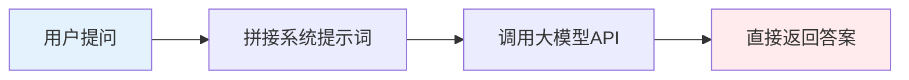
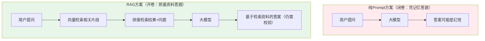
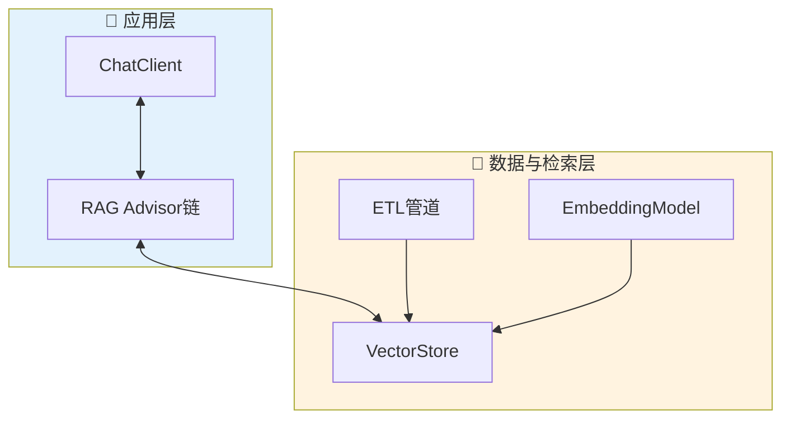
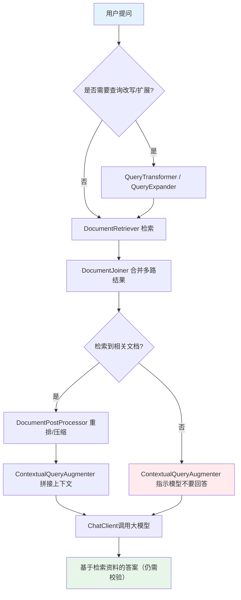
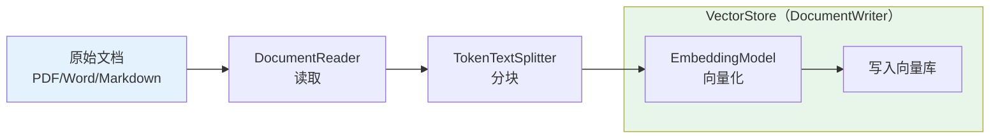
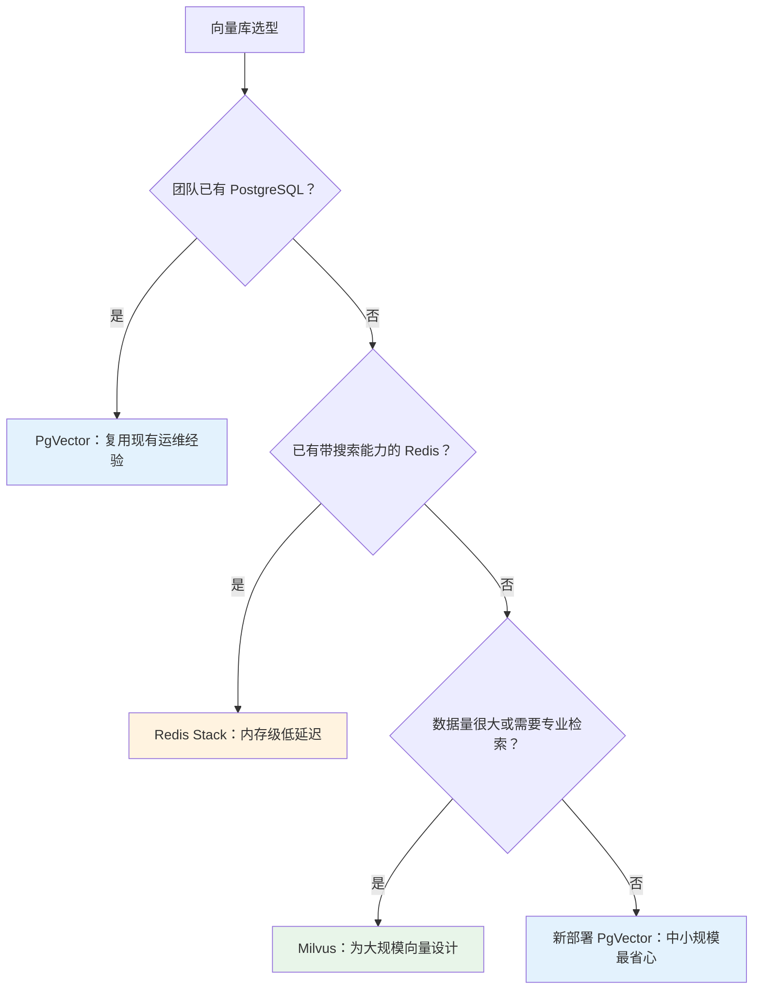

> 用 Spring AI 2.0 搭建 RAG 知识库，核心只有三步：把文档切块写入向量库，给 `ChatClient` 挂上 `RetrievalAugmentationAdvisor`，再调好相似度阈值与 topK。Spring AI 2.0.0 已于 2026 年 6 月 12 日正式 GA，基于 Spring Boot 4 与 Spring Framework 7，本文以当前稳定版 2.0.1 为准。本文从"为什么需要 RAG"讲起，拆解 Modular RAG 架构，并用可运行的 Java 代码搭出一个企业知识库问答服务。
>
> 📌 **核心论文**：[Modular RAG: Transforming RAG Systems into LEGO-like Reconfigurable Frameworks](https://arxiv.org/abs/2407.21059)（arXiv:2407.21059）
>
> 📌 **适合人群**：Java 后端开发者、正在评估自建大模型知识库方案的架构师


<VideoPlayer
src="//cdn.smallyoung.cn/smallyoung_blog/spring-ai-rag/Spring_AI_2.mp4"
/>

<MindMapFloat title="Spring AI 2.0 RAG知识图谱">

```mindmap-data
# Spring AI 2.0 RAG
## 为什么需要
- 大模型知识截止与幻觉
- 私有文档装不进上下文窗口
- 微调成本高、更新慢
## 核心机制
- ChatClient + Advisor 链
- Modular RAG：检索前/检索/检索后/生成
- 检索为空时默认拒答
## 三种落地路径
- QuestionAnswerAdvisor：Naive RAG
- RetrievalAugmentationAdvisor：模块化
- 查询改写与多查询扩展
## 数据入库
- Reader → Splitter → VectorStore
- TokenTextSplitter 中文断句
- 入库与查询必须用同一 Embedding 模型
## 选型与避坑
- PgVector / Redis Stack / Milvus
- 阈值与 topK 先看分数再调
- 2.0 依赖改名与构造器弃用
```

</MindMapFloat>

## 关于本文档

本文面向已经了解 Spring Boot 基础、但尚未接触 Spring AI RAG 能力的 Java 开发者。所有 API 均对照 Spring AI 2.0.1 官方参考文档与源码核实，读完你可以从零跑通一个"上传文档 → 向量入库 → 自然语言问答"的知识库服务。

- ✅ RAG 解决的核心问题，以及为什么它比纯微调更适合企业场景
- ✅ Spring AI 2.0 的 Modular RAG 架构与 Advisor 体系
- ✅ `QuestionAnswerAdvisor` 与 `RetrievalAugmentationAdvisor` 的区别与选型
- ✅ 从文档读取、分块到向量入库的完整 ETL 管道（含中文断句配置）
- ✅ 向量数据库对比、阈值调优，以及 2.0 升级中的依赖与 API 变化

## 1. 为什么Java后端要自己做RAG

### 1.1 纯Prompt方案是怎么工作的？

想象这样一个场景：公司上线了内部助手，员工问"差旅报销的审批流程是什么"，模型却自信地编出一套根本不存在的流程。原因很简单：大多数团队接入大模型的方式，就是"把问题直接丢给模型"：用户提问 → 拼接系统提示词 → 调用 Chat API → 返回答案。这种方式对通用问答足够用，一旦涉及企业内部制度、最新产品文档、专属业务数据，模型要么答不出来，要么"一本正经地编造"。



### 1.2 纯Prompt/纯微调方案的核心局限

下表列出了四类典型局限。可以看到，它们的共同点是：模型"不知道"企业私有且持续变化的数据。

| 局限 | 具体表现 | 真实案例 |
|------|----------|----------|
| 知识截止 | 模型训练数据有时间边界，无法感知最新信息 | 客服机器人不知道公司上周刚发布的新资费政策 |
| 幻觉问题 | 模型在缺乏依据时会自信地编造答案 | 询问内部审批流程时模型编出一套不存在的步骤 |
| 微调成本高 | 每次数据更新都要重新训练，周期以天/周计 | 产品文档每周迭代，微调节奏完全跟不上 |
| 上下文有限 | 无法把全部私有文档塞进单次请求 | 千页级技术手册无法整体作为 Prompt 输入 |

> [!IMPORTANT]
> 核心矛盾在于：企业需要的是"基于最新私有数据的准确回答"，而纯 Prompt/纯微调方案给到的是"基于训练时刻通用知识的概率生成"。RAG 正是为了弥合这个矛盾而生。

### 1.3 RAG的核心思路：把闭卷考试变成开卷考试

RAG（Retrieval-Augmented Generation，检索增强生成）的本质是"先查资料，再回答问题"。可以类比考试：纯 Prompt 方案是**闭卷考试**，全靠模型的记忆；RAG 是**开卷考试**，先把私有文档向量化存入知识库，提问时先做语义检索，把命中的片段作为上下文交给模型，让它"照着资料答题"。



## 2. Spring AI 2.0 的 RAG 核心架构

### 2.1 整体架构概览

Spring AI 2.0 要求 Spring Boot 4.0/4.1 与 Spring Framework 7 作为基线。它把 RAG 能力沉淀成 `ChatClient` 之上的一组 **Advisor（顾问）**。你可以把 Advisor 类比成 Servlet 的 Filter 链：请求进入模型之前，依次经过各个 Advisor 做"加工"，RAG Advisor 的加工动作就是"检索资料并拼进 Prompt"。你不需要手写检索和拼接 Prompt 的胶水代码，只要把 `VectorStore` 和 Advisor 组装起来即可。



### 2.2 Modular RAG：Spring AI 的设计蓝本

Spring AI 官方文档说明，其 RAG 实现受 Modular RAG 思想启发：把检索增强流程拆成可插拔的模块，而不是写死一条"检索→拼接→生成"的流水线。每一类模块在 Spring AI 中都有对应的组件：

| 阶段 | 职责 | Spring AI 组件 |
|------|------|----------------|
| Pre-Retrieval（检索前） | 查询改写、压缩、翻译、扩展，让问题更适合检索 | `RewriteQueryTransformer`、`CompressionQueryTransformer`、`TranslationQueryTransformer`、`MultiQueryExpander` |
| Retrieval（检索） | 从向量库召回相关片段，并合并多路结果 | `VectorStoreDocumentRetriever`、`ConcatenationDocumentJoiner` |
| Post-Retrieval（检索后） | 重排序、去重、压缩，缓解"lost-in-the-middle" | `DocumentPostProcessor` |
| Generation（生成） | 把处理后的上下文拼接进最终 Prompt | `ContextualQueryAugmenter` |

> [!NOTE]
> 这套模块化思路来自论文 [Modular RAG: Transforming RAG Systems into LEGO-like Reconfigurable Frameworks](https://arxiv.org/abs/2407.21059)（arXiv:2407.21059），核心观点是把 RAG 系统拆成可自由组合的"乐高积木"。Spring AI 是"受其启发"的工程实现，并非论文的官方实现。

### 2.3 完整工作流程

一次 `RetrievalAugmentationAdvisor` 请求，从用户提问到返回答案，会经过下面这条链路。注意"检索不到相关文档"这个分支：它的默认行为是让模型拒答，而不是放任模型自由发挥。



## 3. 三种核心RAG实现方式

Spring AI 2.0 提供了从简单到复杂的三种落地路径，选哪种取决于你对检索质量和开发成本的权衡。

### 3.1 QuestionAnswerAdvisor（最简单）

`QuestionAnswerAdvisor` 是 Naive RAG 的直接实现：拿到问题后做一次向量检索，把检索到的文档**追加到用户问题文本之后**交给模型。代码量最少，适合快速验证。

```java
// 依赖：spring-ai-vector-store-advisor（2.0 中由 spring-ai-advisors-vector-store 更名而来）
// 场景：知识库问答的最小可行版本

var qaAdvisor = QuestionAnswerAdvisor.builder(vectorStore)
        .searchRequest(SearchRequest.builder()
                .similarityThreshold(0.55) // 示意值：请先按 7.1 节打印真实分数，再确定自己的阈值
                .topK(5)                  // 只取最相关的5个片段
                .build())
        .build();

String answer = chatClient.prompt()
        .advisors(qaAdvisor)
        .user("公司报销流程是怎样的？")
        .call()
        .content();
```

| 维度 | 说明 |
|------|------|
| 适用场景 | 知识库结构简单、检索需求单一、追求最快上线的原型或内部工具 |
| 优势 | 代码量少，几乎零配置即可跑通 |
| 局限 | 不支持查询改写、多路检索，复杂问题召回效果一般 |

### 3.2 RetrievalAugmentationAdvisor（模块化实现）

`RetrievalAugmentationAdvisor` 基于模块化架构，是官方为"最常见 RAG 流程"提供的开箱即用实现，允许你显式组装检索器、查询转换器、后处理器等模块。

```java
// 依赖：spring-ai-rag
// 场景：需要精细控制检索阈值、返回数量的标准RAG流程

var ragAdvisor = RetrievalAugmentationAdvisor.builder()
        .documentRetriever(VectorStoreDocumentRetriever.builder()
                .vectorStore(vectorStore)
                .similarityThreshold(0.55) // 示意值：请先按 7.1 节打印真实分数，再确定自己的阈值
                .topK(6)
                .build())
        .build();

String answer = chatClient.prompt()
        .advisors(ragAdvisor)
        .user("最新版的产品保修政策有哪些变化？")
        .call()
        .content();
```

| 特点 | 说明 |
|------|------|
| 模块化组装 | 检索器、查询转换器、查询扩展器、后处理器、增强器均可独立替换 |
| 默认拒答 | 检索结果为空时，默认指示模型不要回答，而不是瞎编 |
| 允许空上下文 | 通过 `ContextualQueryAugmenter.builder().allowEmptyContext(true)` 关闭拒答 |
| 链路位置可调 | 构建器提供 `order(...)`，可调整其在 Advisor 链中的执行顺序 |

### 3.3 带查询改写与多查询扩展（最强大）

用户提问口语化、信息量不足时，可以在检索前加一层查询处理：`RewriteQueryTransformer` 让大模型把问题改写得更适合检索；`MultiQueryExpander` 把一个问题扩展成多个角度的子查询，分别检索后再合并（默认会保留原始查询）。

```java
// 场景：用户问题较模糊，先改写，再扩展成多个子查询
// 官方建议：给 QueryTransformer 使用的 ChatClient 配置低温度（如 0.0），结果更稳定
// 2.0 中 Options 通过构建器创建，defaultOptions 接收 ChatOptions.Builder

ChatClient.Builder lowTempBuilder = chatClientBuilder.clone()
        .defaultOptions(ChatOptions.builder().temperature(0.0));

var advancedRagAdvisor = RetrievalAugmentationAdvisor.builder()
        // 第一步：改写查询
        .queryTransformers(RewriteQueryTransformer.builder()
                .chatClientBuilder(lowTempBuilder)
                .build())
        // 第二步：扩展为3个角度的子查询（默认包含原始查询）
        .queryExpander(MultiQueryExpander.builder()
                .chatClientBuilder(lowTempBuilder)
                .numberOfQueries(3)
                .build())
        // 第三步：对每个子查询做向量检索
        .documentRetriever(VectorStoreDocumentRetriever.builder()
                .vectorStore(vectorStore)
                .similarityThreshold(0.5)
                .topK(8)
                .build())
        .build();
```

三种方式的选型速查如下：

| 方式 | 额外大模型调用 | 召回质量 | 推荐阶段 |
|------|----------------|----------|----------|
| QuestionAnswerAdvisor | 0 次 | 基础 | 原型验证 |
| RetrievalAugmentationAdvisor | 0 次 | 可控 | 常规上线 |
| + 改写 / 多查询扩展 | 1 次以上 | 更高 | 命中率明显偏低时 |

> [!TIP]
> 查询改写和多查询扩展都会多打一次（或多次）大模型调用，属于"用延迟和成本换准确率"。如果对响应速度敏感，建议只在检索命中率明显偏低时才开启。

## 4. 数据准备：搭建ETL入库管道

### 4.1 为什么ETL质量决定RAG效果

RAG 的答案质量上限，很大程度上取决于向量库里存了什么、怎么切分的。分块太大会稀释语义、检索不精准；分块太小又会丢失上下文。Spring AI 把这套流程抽象为 ETL 三个组件：`DocumentReader` 负责读取，`DocumentTransformer`（如 `TokenTextSplitter`）负责分块，`DocumentWriter`（`VectorStore` 即其实现）负责写入。向量化发生在 `VectorStore` 写入的过程中，并不是独立的一步。



### 4.2 用DocumentReader读取多格式文档

企业知识库通常是 PDF、Word、Markdown 混合存放的，Spring AI 提供了多种 `DocumentReader`。先看如何选：

| Reader | 适用格式 | 额外依赖 |
|--------|----------|----------|
| `TextReader` / `JsonReader` | 纯文本 / JSON | 无（核心模块自带） |
| `MarkdownDocumentReader` | Markdown | `spring-ai-markdown-document-reader` |
| `PagePdfDocumentReader` / `ParagraphPdfDocumentReader` | PDF（按页 / 按目录段落） | `spring-ai-pdf-document-reader` |
| `JsoupDocumentReader` | HTML | `spring-ai-jsoup-document-reader` |
| `TikaDocumentReader` | PDF、DOC/DOCX、PPT/PPTX、HTML 等 | `spring-ai-tika-document-reader` |

格式混杂时，用 Tika 统一解析最省事：

```java
// 场景：用Tika统一解析PDF/Word等多种格式文档
// 依赖：spring-ai-tika-document-reader

@Component
public class KnowledgeBaseReader {

    public List<Document> loadDocuments(Resource resource) {
        // TikaDocumentReader 底层基于 Apache Tika，支持PDF/DOC/DOCX/PPT/PPTX/HTML等格式
        TikaDocumentReader reader = new TikaDocumentReader(resource);
        return reader.read();
    }
}
```

> [!WARNING]
> 官方文档提醒：多数 Reader 通过 `Resource` 构造，内部会按路径或 URL 加载资源。不要直接用用户提交的 URL 去构造它们，否则存在安全风险（如 SSRF）。

### 4.3 用TokenTextSplitter控制分块粒度

`TokenTextSplitter` 按 Token 数把长文档切成适合 Embedding 的小块。**2.0 中所有构造器都已标记弃用（且标注为将移除），请统一使用 `builder()`。** 另外，默认断句符只有英文的 `. ? ! \n`，中文知识库应显式加上中文标点，否则按字数硬切时容易把句子拦腰截断。

```java
// 场景：把长文档按Token数量切分成适合Embedding模型处理的小块
// chunkSize过大会稀释语义，过小会丢失上下文，需要结合业务文档长度调优

@Bean
public TextSplitter textSplitter() {
    return TokenTextSplitter.builder()
            .withChunkSize(800)          // 目标块大小（Token），默认800
            .withMinChunkSizeChars(350)  // 每块最少字符数，默认350
            // 中英文标点一起配置，让分块尽量在句子边界截断
            .withPunctuationMarks(List.of('。', '？', '！', '；', '.', '?', '!', '\n'))
            .build();
}

// 组装完整的ETL入库流程
@Component
public class EtlPipeline {

    private final VectorStore vectorStore;
    private final TextSplitter textSplitter;
    private final KnowledgeBaseReader documentReader;

    public EtlPipeline(VectorStore vectorStore, TextSplitter textSplitter,
                       KnowledgeBaseReader documentReader) {
        this.vectorStore = vectorStore;
        this.textSplitter = textSplitter;
        this.documentReader = documentReader;
    }

    public void ingest(Resource resource, String docId) {
        // 先删除该文档的旧分块，避免重复上传后答案重复
        vectorStore.delete(new FilterExpressionBuilder().eq("docId", docId).build());

        List<Document> rawDocuments = documentReader.loadDocuments(resource);
        // 给每个原始文档打上标识，分块时元数据会复制到所有子块
        rawDocuments.forEach(d -> d.mutate().metadata("docId", docId).build());

        List<Document> chunks = textSplitter.apply(rawDocuments);
        vectorStore.write(chunks);
    }
}
```

> [!WARNING]
> `TokenTextSplitter` 默认使用 `CL100K_BASE` 编码计算 Token（可通过 `withEncodingType(EncodingType.O200K_BASE)` 切换）。它和非 OpenAI 模型的实际分词规则不完全一致，接入其他 Embedding 模型时，建议抽样检查一次分块结果。

## 5. 向量数据库选型对比

### 5.1 三种主流方案的核心差异

Spring AI 通过统一的 `VectorStore` 接口屏蔽了底层差异，但选哪种数据库仍要结合团队现有基础设施。核心思路是：优先考虑"能否复用现有运维能力"，而不是一味追求参数最优。



| 对比维度 | PgVector | Redis | Milvus |
|----------|----------|-------|--------|
| 前置条件 | PostgreSQL 安装 pgvector 扩展 | 需要带搜索能力的 Redis（Redis Stack，或已内置查询引擎的新版本 Redis，请以官方文档为准） | 独立部署集群 |
| 部署复杂度 | 低（可复用现有 PostgreSQL） | 中（需确认已有 Redis 是否带搜索模块） | 中高 |
| 规模特点 | 中小规模最省心，更大规模需压测与调优 | 受内存容量限制 | 面向大规模向量设计 |
| 索引算法 | HNSW / IVFFlat / NONE（精确检索） | HNSW / FLAT | 多种索引（如 HNSW、IVF 系列、DiskANN 等） |
| 事务一致性 | 强（继承 PostgreSQL ACID） | 弱 | 弱 |
| 适合团队 | 已有 PostgreSQL 运维能力 | 追求低延迟且已有 Redis Stack | 数据量大、需要专业检索能力 |

> [!NOTE]
> 表中"规模特点"为经验判断，没有统一的数字上限。真实上限取决于向量维度、索引参数和硬件，上线前请用自己的数据压测。

### 5.2 选型建议

中小规模知识库优先选 PgVector：既能复用数据库运维体系，又能把业务数据和向量数据放在同一个事务边界内管理，工程复杂度最低。数据规模持续增长、或需要多种索引精细调优时，再评估迁移到 Milvus 这类专用向量库。由于业务代码只依赖 `VectorStore` 接口，迁移成本主要在数据重新入库。

PgVector 的 `index-type` 有三个取值，选错会直接影响入库是否成功：

| index-type | 含义 | 特点 |
|-----------|------|------|
| `HNSW`（默认） | 多层图索引 | 查询性能好，建索引慢、占内存多，无需训练，空表即可建索引 |
| `IVFFLAT` | 向量分桶后检索部分桶 | 建索引快、内存省，查询性能较低 |
| `NONE` | 不建索引，精确最近邻 | 召回最准，数据量大时较慢 |

> [!TIP]
> pgvector 的 HNSW / IVFFlat 索引对向量维度有上限（`vector` 类型为 2000 维）。如果使用 4096 维等高维 Embedding 模型，需要降维，或改用 `NONE`，否则在建表或建索引阶段（initialize-schema=true 时）会报错。

## 6. 完整代码实现：企业知识库问答系统

### 6.1 项目依赖与Spring Boot 4基线

Spring AI 2.0 与 Spring Boot 4.0/4.1、Spring Framework 7 配套，**Boot 3.x 项目无法直接使用**。同时，各模型厂商的适配收敛为基于官方 SDK 的少数 provider（OpenAI、Anthropic、Google GenAI 等）。下面是最小可编译的依赖组合，注意导入 BOM、补齐 RAG 与 Advisor 模块、使用 Boot 4 的 Web 起步依赖：

```xml
<!-- 场景：Spring AI 2.0 + PgVector 的最小依赖组合 -->
<parent>
    <groupId>org.springframework.boot</groupId>
    <artifactId>spring-boot-starter-parent</artifactId>
    <!-- 使用 4.0.x 或 4.1.x，具体版本以 start.spring.io 为准 -->
    <version>4.0.3</version>
</parent>

<properties>
    <java.version>21</java.version>
    <spring-ai.version>2.0.1</spring-ai.version>
</properties>

<!-- 导入 Spring AI BOM，统一管理版本（缺少这一段，下面的依赖都没有版本号） -->
<dependencyManagement>
    <dependencies>
        <dependency>
            <groupId>org.springframework.ai</groupId>
            <artifactId>spring-ai-bom</artifactId>
            <version>${spring-ai.version}</version>
            <type>pom</type>
            <scope>import</scope>
        </dependency>
    </dependencies>
</dependencyManagement>

<dependencies>
    <!-- Boot 4 中 spring-boot-starter-web 已更名为 spring-boot-starter-webmvc -->
    <dependency>
        <groupId>org.springframework.boot</groupId>
        <artifactId>spring-boot-starter-webmvc</artifactId>
    </dependency>
    <!-- 模型：Chat + Embedding -->
    <dependency>
        <groupId>org.springframework.ai</groupId>
        <artifactId>spring-ai-starter-model-openai</artifactId>
    </dependency>
    <!-- 向量库：PgVector -->
    <dependency>
        <groupId>org.springframework.ai</groupId>
        <artifactId>spring-ai-starter-vector-store-pgvector</artifactId>
    </dependency>
    <!-- RetrievalAugmentationAdvisor 所在模块（starter 不会自动带入） -->
    <dependency>
        <groupId>org.springframework.ai</groupId>
        <artifactId>spring-ai-rag</artifactId>
    </dependency>
    <!-- 仅在使用 QuestionAnswerAdvisor 时需要，6.3 的主流程可不引入 -->
    <dependency>
        <groupId>org.springframework.ai</groupId>
        <artifactId>spring-ai-vector-store-advisor</artifactId>
    </dependency>
    <!-- 多格式文档读取 -->
    <dependency>
        <groupId>org.springframework.ai</groupId>
        <artifactId>spring-ai-tika-document-reader</artifactId>
    </dependency>
</dependencies>
```

> [!WARNING]
> `spring-ai-starter-model-openai` 与 `spring-ai-starter-vector-store-pgvector` 的依赖树里并不包含 `spring-ai-rag` 和 `spring-ai-vector-store-advisor`。漏掉它们，`RetrievalAugmentationAdvisor` 与 `QuestionAnswerAdvisor` 会在编译期找不到类。

### 6.2 配置向量数据库

先用 Docker 启动一个带 pgvector 扩展的 PostgreSQL，再配置连接与索引参数。`dimensions` 必须与所选 Embedding 模型的输出维度一致（`text-embedding-3-small` 为 1536 维）。

```bash
# 启动带 pgvector 扩展的 PostgreSQL（镜像已预装扩展）
docker run -d --name pgvector \
  -e POSTGRES_PASSWORD=postgres -e POSTGRES_DB=rag_db \
  -p 5432:5432 pgvector/pgvector:pg17
```

```yaml
# application.yml
# 场景：配置PgVector连接信息与索引参数
spring:
  servlet:
    multipart:
      max-file-size: 50MB       # Boot 默认单文件仅 1MB，PDF 制度文档很容易超限
      max-request-size: 50MB
  datasource:
    url: jdbc:postgresql://localhost:5432/rag_db
    username: postgres
    password: postgres
  ai:
    openai:
      api-key: ${OPENAI_API_KEY}
      embedding:
        model: text-embedding-3-small   # 显式指定，避免与 dimensions 不一致
    vectorstore:
      pgvector:
        index-type: HNSW
        distance-type: COSINE_DISTANCE
        dimensions: 1536                  # 必须与 Embedding 模型输出维度一致
        initialize-schema: true           # 默认 false，需显式开启才会自动建表建索引
```

### 6.3 对外暴露入库与问答接口

下面的 Controller 在 `ChatClient` 层统一注册默认 Advisor，业务代码无需重复组装；系统提示词用中文约束回答风格，因为 Advisor 内置的"拒答"提示模板是英文的。入库接口复用 4.3 节的 `EtlPipeline`。

```java
// 场景：暴露"上传文档"和"知识库问答"两个REST接口
// 说明：省略 import，使用 IDE 自动导入即可

@RestController
@RequestMapping("/api/knowledge-base")
public class KnowledgeBaseController {

    // 请求体使用 record，前端传 {"question": "..."}
    public record AskRequest(String question) {}

    private final ChatClient chatClient;
    private final EtlPipeline etlPipeline;

    public KnowledgeBaseController(ChatClient.Builder chatClientBuilder,
                                   VectorStore vectorStore,
                                   EtlPipeline etlPipeline,
                                   @Value("${rag.similarity-threshold:0.3}") double threshold,
                                   @Value("${rag.top-k:6}") int topK) {
        this.etlPipeline = etlPipeline;

        // 第一步：组装 RAG Advisor
        var ragAdvisor = RetrievalAugmentationAdvisor.builder()
                .documentRetriever(VectorStoreDocumentRetriever.builder()
                        .vectorStore(vectorStore)
                        .similarityThreshold(threshold)
                        .topK(topK)
                        .build())
                .build();

        // 第二步：注册为 ChatClient 的默认 Advisor
        this.chatClient = chatClientBuilder
                .defaultSystem("你是企业知识库助手，只依据检索到的资料回答问题，并使用中文作答。"
        + "如果资料中没有明确答案，请直接回答\"根据现有资料无法回答\"，不要推测或补充资料之外的内容。")
                .defaultAdvisors(ragAdvisor)
                .build();
    }

    // 上传文档并入库
    @PostMapping("/documents")
    public String upload(@RequestParam("file") MultipartFile file) {
        etlPipeline.ingest(file.getResource(), file.getOriginalFilename());
        return "ok";
    }

    // 知识库问答
    @PostMapping("/ask")
    public String ask(@RequestBody AskRequest request) {
        return chatClient.prompt()
                .user(request.question())
                .call()
                .content();
    }
}
```

### 6.4 启动并验证

启动应用后，先上传一份文档，再提问。如果检索结果为空（没有片段通过相似度阈值），默认行为是指示模型拒答，这能降低幻觉风险。但注意：只要有不相关片段通过了阈值，模型仍可能基于它们编造答案，所以阈值调优和提示词约束同样重要。

```bash
# 1. 上传文档
curl -F "file=@./差旅管理制度.pdf" http://localhost:8080/api/knowledge-base/documents

# 2. 提问
curl -X POST http://localhost:8080/api/knowledge-base/ask \
  -H "Content-Type: application/json" \
  -d '{"question": "出差住宿费的报销标准是什么？"}'
```

## 7. 最佳实践与常见问题

### 7.1 相似度阈值与topK的调优

相似度阈值和 topK 是影响 RAG 效果最直接的两个参数，很多"答不准"的问题源于这两个参数没调好。分数的分布因 Embedding 模型和语言而异，**不要凭感觉定阈值，先把召回分数打印出来**：

```java
// 场景：用阈值0（接受全部）+ 较大topK，观察真实的相似度分布，再决定阈值
var probe = VectorStoreDocumentRetriever.builder()
        .vectorStore(vectorStore)
        .similarityThreshold(0.0)
        .topK(10)
        .build();

probe.retrieve(new Query("公司报销流程是怎样的？"))
        .forEach(doc -> System.out.printf("%.3f | %s%n", doc.getScore(), doc.getText()));
```

假设你观察到"相关片段分数集中在 0.6 以上、无关片段在 0.4 以下"（实际分布取决于 Embedding 模型和语言，中文场景分数可能整体偏低），再把阈值设在两者之间：

```java
// ❌ 错误示范：阈值设得过低，大量不相关片段被塞进上下文，稀释真正有用的信息
VectorStoreDocumentRetriever.builder()
        .vectorStore(vectorStore)
        .similarityThreshold(0.1)
        .topK(20)
        .build();

// ✅ 示范（0.55 与 6 均为示意值，以你的实测分布为准）
VectorStoreDocumentRetriever.builder()
        .vectorStore(vectorStore)
        .similarityThreshold(0.55)
        .topK(6)
        .build();
```

### 7.2 常见问题排查

下表汇总了上线前后最常遇到的五类问题，按"现象 → 原因 → 解决方案"逐项排查即可。

| 问题 | 原因 | 解决方案 |
|------|------|----------|
| 检索结果总是为空 | 阈值过高，或入库与查询用了不同的 Embedding 模型 | 先把阈值降到 0 看原始分数，并确认两端模型一致 |
| 答案里出现无关内容 | topK 过大，混入低相关度片段 | 调低 topK，并配合 `DocumentPostProcessor` 做重排 |
| 分块后语义割裂 | chunkSize 过小，或未配置中文标点 | 调大 chunkSize，并使用 `withPunctuationMarks` 加入中文标点 |
| 高并发下响应变慢 | 每次请求都做查询改写/扩展，多了大模型调用 | 只在必要场景开启，或对高频问题做结果缓存 |
| 重复上传后答案重复 | 每次入库都会新增一批分块 | 入库前按 docId 元数据删除旧分块（见 4.3 节 ingest 方法） |


> [!CAUTION]
> 生产环境务必确认"入库时用的 Embedding 模型"和"查询时用的 Embedding 模型"是同一个。切换 Embedding 模型后，历史向量的语义空间失效，且 `dimensions` 也可能变化，必须清空并全量重新入库。

### 7.3 Spring AI 2.0 升级与依赖踩坑清单

按旧版教程（1.x 或 Boot 3）写代码，在 2.0 上常见的坑集中在下面几处：

| 旧写法 | 2.0 的正确做法 | 影响 |
|--------|----------------|------|
| Boot 3.x 项目引入 Spring AI 2.0 | 升级到 Boot 4.0/4.1 | 运行期可能出现 `NoSuchMethodError` 等错误 |
| `spring-ai-advisors-vector-store` | 更名为 `spring-ai-vector-store-advisor` | 依赖找不到 |
| `spring-boot-starter-web` | Boot 4 使用 `spring-boot-starter-webmvc` | 依赖名不再沿用旧写法，请按 Boot 4 迁移指南使用 webmvc，避免绝对化的"缺少 Web 能力" |
| `new TokenTextSplitter(...)` | `TokenTextSplitter.builder()...build()` | 构造器已弃用且标注将移除 |
| `options.setTemperature(0.7)` 等 setter | `XxxOptions.builder().temperature(0.7).build()` | Options 改为不可变，setter 已移除 |
| 依赖 `RetrievalAugmentationAdvisor` 却只引入 starter | 额外引入 `spring-ai-rag` | 编译期找不到类 |
| `spring.ai.openai.embedding.options.model` | `spring.ai.openai.embedding.model` | 旧键仍兼容，但会有废弃警告，后续版本可能移除 |

> [!TIP]
> 升级前先通读官方 Upgrade Notes。新项目建议直接用 start.spring.io 生成骨架，再补充 `spring-ai-rag` 等模块。

## 8. 总结

### 8.1 核心概念速查

下表把全文出现的核心概念压缩成一句话，方便回顾和日后速查。

| 核心概念 | 一句话解释 |
|---------|-----------|
| RAG | 先检索相关资料、再让大模型基于资料生成答案的技术范式 |
| Advisor | `ChatClient` 的拦截器链，RAG 通过它在请求前注入检索结果 |
| QuestionAnswerAdvisor | 最简单的 Naive RAG，把检索结果追加到用户问题后 |
| RetrievalAugmentationAdvisor | 基于模块化架构的 RAG 实现，可组装改写、扩展、后处理 |
| ETL 管道 | `DocumentReader` → `TokenTextSplitter` → `VectorStore` 的入库流程 |
| VectorStore | Spring AI 统一封装的向量库读写接口，写入时自动调用 Embedding |

### 8.2 学习路径建议

建议按"先跑通、再打磨、后优化"的顺序推进，每一步都用真实文档验证效果。

> [!TIP]
> **学习路径建议**：
> 1. 先用 `QuestionAnswerAdvisor` 跑通最小可行的知识库问答原型
> 2. 搭建规范的 ETL 入库管道，重点打磨分块策略（含中文标点）
> 3. 切换到 `RetrievalAugmentationAdvisor`，按需引入查询改写与多查询扩展
> 4. 结合数据规模选择向量数据库，先打印召回分数，再持续调优阈值与 topK

## 9. 参考资料

### 9.1 核心论文

本文所述的模块化 RAG 设计思想，来自下面这篇论文。

| 论文 | 作者/机构 | 年份 | 主要贡献 |
|------|-----------|------|----------|
| [Modular RAG: Transforming RAG Systems into LEGO-like Reconfigurable Frameworks](https://arxiv.org/abs/2407.21059) | Yunfan Gao 等 | 2024 | 提出模块化 RAG 架构思想，Spring AI 的 RAG 模块设计受其启发 |

### 9.2 推荐资源

以下均为官方一手资料，文中的 API 与依赖名以 Spring AI 2.0.1 版本文档为准。

| 资源 | 用途 |
|------|------|
| [Spring AI 2.0.0 GA 官方发布说明](https://spring.io/blog/2026/06/12/spring-ai-2-0-0-GA-available-now/) | 了解 2.0 的基线与新特性 |
| [Spring AI Reference：Retrieval Augmented Generation](https://docs.spring.io/spring-ai/reference/api/retrieval-augmented-generation.html) | Advisor 与 RAG 模块的权威说明 |
| [Spring AI Reference：ETL Pipeline](https://docs.spring.io/spring-ai/reference/api/etl-pipeline.html) | Reader、Splitter、Writer 的完整参数 |
| [Spring AI Reference：PGvector](https://docs.spring.io/spring-ai/reference/api/vectordbs/pgvector.html) | PgVector 配置项与索引类型 |
| [Spring AI Upgrade Notes](https://docs.spring.io/spring-ai/reference/upgrade-notes.html) | 1.x 升级到 2.0 的变更清单 |
