> 同样是"调用大模型做事"，为什么有的项目跑三天就散架，有的却能稳定支撑上万并发的企业级业务？答案往往不在模型能力，而在架构选择上。
>
> 📌 **核心论文**：[ReAct: Synergizing Reasoning and Acting in Language Models](https://arxiv.org/abs/2210.03629)（arXiv:2210.03629）
>
> 📌 **适合人群**：正在做 Agent 技术选型的后端/AI 工程师、AI 初学者


<MindMapFloat title="Agent 架构知识图谱">

```mindmap-data
# Agent 架构
## 为什么需要架构范式
- 单次调用无法感知外部世界、拆解任务与纠错
- Workflow 与 Agent 的分野（Anthropic 定义）
- 2026 年视角：Agent = Model + Harness
## 推理与自纠错范式
- ReAct：思考-行动-观察，现代实现是原生 Tool Calling
- Plan & Execute：先规划后执行
- Reflection：生成-评估-改写，必须限制轮数
## 协作与编排架构
- 多Agent：Orchestrator-Workers，提升 90.2% 但约 15 倍 Token
- Router+Skill：分类路由 + Agent Skills 渐进加载
- Blackboard：共享状态，适合探索型问题
- Graph/Workflow：LangGraph 1.0 / Microsoft Agent Framework 1.0
## 2026 生态与标准
- MCP / A2A / Agent Skills 三层协议，归入 AAIF
- 上下文工程、Harness 与 Deep Agents
- Java：Spring AI 2.0、Spring AI Alibaba、AgentScope Java
## 落地与选型
- 按任务可预测性选架构，从最简单方案起步
- Spring AI 2.0 最小可运行示例
- 评估先行、限制轮数、监控 Token
```

</MindMapFloat>

## 关于本文档

这篇文章面向想要系统理解 AI Agent 架构选型的工程师和技术爱好者，覆盖从最基础的单 Agent 循环到企业级 Graph/Workflow 架构的完整光谱。本次（2026-10-26）对全文做了时效性校验：更新了框架状态、替换了过时的代码写法，并补充了协议标准、上下文工程等新概念。

- ✅ 理解 ReAct、Plan&Execute、Reflection 三大核心推理范式的差异
- ✅ 掌握单Agent、多Agent、Router+Skill、Blackboard、Graph/Workflow 五种协作架构
- ✅ 看懂 2026 年主流框架（LangGraph、Microsoft Agent Framework、Spring AI 2.0）的定位与迁移要点
- ✅ 了解 MCP、A2A、Agent Skills 三层开放协议与上下文工程这条新主线
- ✅ 获得基于 Spring AI 2.0 真实 API 的 Java 示例，以及架构选型的决策方法

## 1. 为什么 Agent 需要"架构"，而不是一句 Prompt

### 1.1 最朴素的做法是怎么工作的？

很多人接触 Agent 的第一反应是："把任务丢给大模型，让它自己想办法完成"。这种最朴素的做法可以称为单次调用（Single Call）模式：一次 Prompt，一次输出，没有中间步骤。

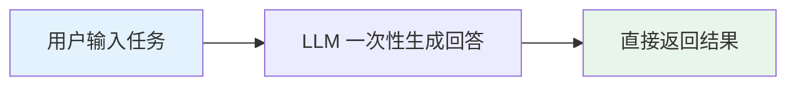

这种模式在简单问答、文本改写等任务上表现不错，但一旦任务需要多步骤推理、调用外部工具、或者协调多个专业角色，它就会迅速失效。

### 1.2 单次调用模式的核心局限

| 局限 | 具体表现 | 真实案例 |
|------|----------|----------|
| 无法感知外部世界 | 模型只能依赖训练数据，无法获取实时信息 | 问"今天的汇率"，模型只能瞎编 |
| 无法拆解复杂任务 | 长链路任务（如"帮我重构这个项目"）一次生成必然遗漏步骤 | 生成的代码引用了不存在的文件 |
| 缺乏纠错机制 | 一步错，步步错，没有观察-反馈环节 | 工具调用参数错误后无法自我修正 |
| 无法协作分工 | 单一模型既要做规划又要做执行，角色混乱 | 既要写文案又要做事实核查，质量顾此失彼 |

> [!IMPORTANT]
> 核心矛盾在于：真实业务需要的是"感知-决策-行动-观测"的闭环能力，而单次调用只提供了"输入-输出"的映射。这正是各类 Agent 架构诞生的原因。

### 1.3 Agent 架构的核心思想

所有 Agent 架构的本质，都是在 LLM 外部加一层"控制结构"，让模型具备多步骤、可观测、可纠错、可协作的能力。行业内把这套体系拆成两大类：**workflow（工作流）** 和 **agent（智能体）**。

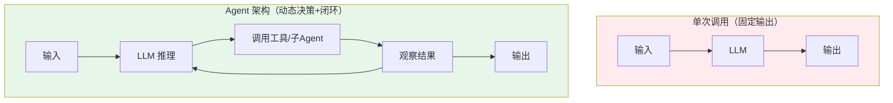

Anthropic 在其工程博客中给出了一个被广泛引用的定义：工作流是通过预先写好的代码路径来编排 LLM 和工具的系统，而智能体则是让 LLM 自主决定推进方式、动态掌控整个任务执行过程的系统（来源：Anthropic《Building Effective Agents》）。这个区分是理解后文所有架构的基础坐标系。

> [!NOTE]
> 2026 年的官方文档把这个思路进一步压缩成一个公式：Agent = Model + Harness。Harness（运行外壳）指模型循环之外的一切：提示词、工具、中间件、上下文管理。LangChain 的 `create_agent` 就被定位为一个"最小可配置的 harness"。后文第 12 章会展开这个新主线。


## 2. 单Agent架构：最基础的智能体模式

### 2.1 整体结构

单Agent架构指的是"一个 LLM + 一套工具集"独立完成任务，不涉及多角色协作。它是绝大多数 Agent 系统的起点。

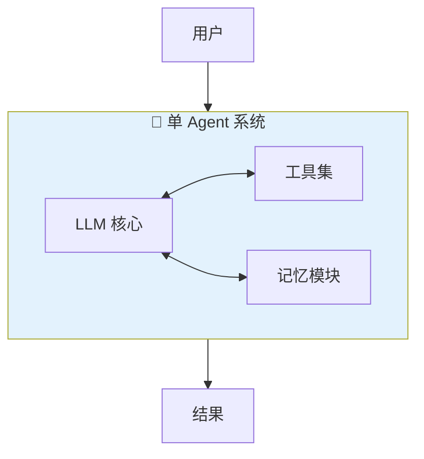

### 2.2 四大基础组件

一个可用的单Agent系统离不开四个基础模块，这也是排查"Agent 为什么不稳定"时最先要检查的地方。

| 模块 | 作用 | 缺失后的表现 |
|------|------|--------------|
| LLM | 推理与决策核心 | 无 LLM 无从谈起 |
| Planning（规划） | 拆解任务、决定下一步 | 停留在"给建议"阶段，不会真正执行 |
| Memory（记忆） | 维护短期上下文和长期状态 | 长任务中途"失忆"，重复劳动或自相矛盾 |
| Tools（工具） | 与外部世界交互（搜索、代码执行、API） | 只能纸上谈兵，无法真正完成任务 |

> [!NOTE]
> 这一分类被称为 Agent Loop 的四要素，在社区资料中被反复提及：缺少工具能力，Agent 只能停留在"给建议"层面无法真正执行；缺少记忆机制，稍长一点的任务就会中途遗忘上下文；上下文管理不当，模型的行为也容易偏离预期（来源：JavaGuide 社区文档）。最后这一点近两年已发展为独立的工程方向——上下文工程。

### 2.3 适用场景与局限

单Agent架构最大的优点是简单、调试成本低、延迟低，缺点是当任务需要多个专业视角（比如"既要写代码又要做安全审计"）时，容易出现角色混乱。这也是后文引出 ReAct、多Agent等架构的直接动机。

| 维度 | 说明 |
|------|------|
| 适用场景 | 客服问答、单一文档摘要、简单代码补全 |
| 优势 | 架构简单、延迟低、调试成本低 |
| 局限 | 无法很好支撑多角色分工和长链路复杂任务 |


## 3. ReAct 架构：推理与行动交织的核心范式

### 3.1 ReAct 的核心机制

ReAct（Reasoning + Acting）是现代 Agent 框架默认循环的思想来源。论文的核心思路是让大语言模型以交织的方式同时产出推理轨迹和具体行动，二者相互增强：推理帮助模型归纳、追踪并更新行动计划，也能应对执行过程中的异常；而行动则让模型有机会与外部知识库或真实环境交互，从而获取推理阶段无法得到的额外信息。

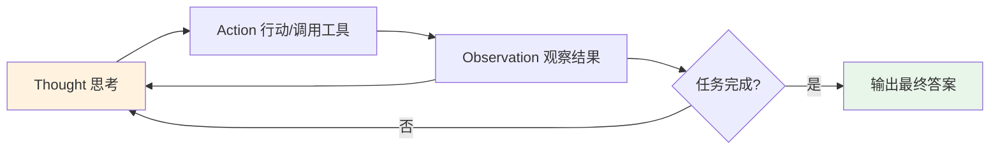

> [!NOTE]
> ReAct 的效果验证覆盖了问答、事实核查、文本游戏和网页导航等多个基准。在 ALFWorld 和 WebShop 这两个交互式决策基准上，仅用一到两个上下文示例，ReAct 就分别以约 34% 和 10% 的绝对成功率优势超过了模仿学习和强化学习方法（数据来源：ReAct 原始论文）。

### 3.2 经典 ReAct 循环：文本协议

```
# ReAct 核心循环伪代码
while not task_done:
    thought = llm.reason(context)       # 思考：分析当前状态，决定下一步
    action = llm.decide_action(thought) # 行动：选择工具及参数
    observation = tool.execute(action)  # 观察：执行工具并获取真实反馈
    context.append(thought, action, observation)
    task_done = llm.check_completion(context)
```

这套循环的关键在于"观察"环节引入了真实世界的反馈，而不是让模型凭空想象下一步该做什么，这也是 ReAct 相较于纯 Chain-of-Thought 推理更不容易产生幻觉的原因。早期实现会让模型输出 `Thought: ... Action: ...` 形式的纯文本，再由程序用字符串匹配去解析。

### 3.3 现代实现：原生 Tool Calling 取代文本解析

今天主流模型 API 都提供原生的工具调用能力：模型直接返回结构化的"调用哪个工具、参数是什么"，而不是一段需要正则解析的文字。框架（如 Spring AI、LangChain）把"调用工具 → 回传结果 → 再次请求模型"的循环封装起来，ReAct 的思想没变，实现方式变了。

| 对比维度 | 经典文本协议 | 原生 Tool Calling |
|----------|--------------|-------------------|
| 输出格式 | 自由文本（`Action: xxx`） | 结构化工具调用（名称 + JSON 参数） |
| 解析方式 | 正则/字符串匹配，易碎 | 框架直接反序列化，参数有 Schema |
| 循环控制者 | 自己写 `while` 循环 | 框架托管（如 Spring AI 的 `ToolCallingAdvisor`） |
| 多工具并行 | 需要自己设计 | 模型可一次返回多个调用 |
| 可靠性 | 格式稍有偏差就解析失败 | 格式由 API 保证 |

> [!WARNING]
> 循环交给框架托管，不等于不用管它。务必在应用层设置总超时、最大轮数和 Token 预算，否则一次异常的工具返回就可能让 Agent 反复调用到账单爆炸。


### 3.4 适用场景与局限

| 维度 | 说明 |
|------|------|
| 适用场景 | 需要实时外部信息或动态决策的任务，如联网问答、多轮工具调用 |
| 优势 | 灵活性高，能根据观察结果随时调整策略 |
| 局限 | 调试难度较高，多轮工具调用会消耗较多 Token；社区实践普遍反映调试和 Token 成本是常见痛点 |

## 4. Plan & Execute 架构：先规划后执行

### 4.1 核心思想

与 ReAct 每一步都"边想边做"不同，Plan & Execute 架构强调先制定完整计划，再按步骤执行。它的思想源头之一是 [Plan-and-Solve Prompting](https://arxiv.org/abs/2305.04091)（arXiv:2305.04091，ACL 2023）：这篇论文提出的是一种提示词层面的做法，让模型先"制定计划"再"执行计划"，用来减少 Zero-shot CoT 中的漏步错误。

需要澄清的是，Plan-and-Solve 本身是在单次推理中完成"计划+求解"的提示技巧。把它升级为 Agent 架构，是后来的工程演进：把 Planner 与 Executor 拆成独立组件，计划可以持久化、校验，执行阶段还能调用工具。

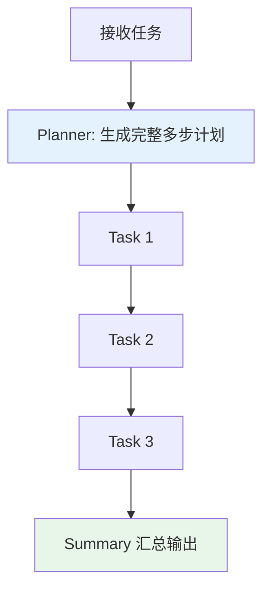

### 4.2 与 ReAct 的关键差异

| 维度 | ReAct | Plan & Execute |
|------|-------|-----------------|
| 决策方式 | 走一步看一步，动态推理 | 先整体规划，再顺序执行 |
| 适用任务 | 任务路径不确定、需要频繁纠错 | 任务关系明确、步骤可预先拆解的长期任务 |
| 灵活性 | 高，能随时调整 | 较低，属于结构化工作流程，动态调整能力有限 |
| Token 消耗 | 较高（每步都推理） | 相对可控（一次规划，批量执行） |

### 4.3 典型实现与组合用法

BabyAGI 是 2023 年走红的任务驱动型自主 Agent 项目，它实现了"生成任务列表→执行→再规划"的循环，是 Plan & Execute 思路在工程上的早期范例。

> [!TIP]
> 实践中很少有系统是"纯 Plan & Execute"或"纯 ReAct"，更常见的做法是组合使用：先用 Plan & Execute 拆出大纲，再用 ReAct 执行每个子任务，中间穿插 Reflection 环节做质量校验。Anthropic 的长任务 harness 也采用了"规划者 + 生成者 + 评估者"的分工（见第 5 章）。

## 5. Reflection 架构：让 Agent 学会自我纠错

### 5.1 Reflexion 的核心机制

Reflection（反思）架构让 Agent 在失败或产出不达标后，用自然语言总结"哪里错了、下次怎么改"，再带着这段反思重试。代表工作是 [Reflexion](https://arxiv.org/abs/2303.11366)（arXiv:2303.11366，NeurIPS 2023）：它不更新模型权重，而是把环境反馈转成文字形式的反思，存入情景记忆，供下一轮决策参考。

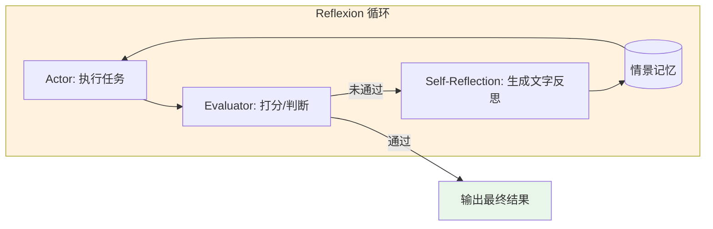

论文报告，Reflexion 在 HumanEval 代码基准上达到 91% 的 pass@1，超过当时 GPT-4 的 80%（数据来源：Reflexion 论文摘要）。

### 5.2 工程落地：生成器与评估器分离

落地时最关键的设计是把"干活的"和"挑错的"拆开。Anthropic 在长时间自主开发的 harness 中采用了规划、生成、评估三个分工明确的 Agent，评估者用少样本示例和评分标准校准；同时在上下文窗口之间用结构化的交接产物做"上下文重置"，而不是只做压缩（来源：InfoQ 对 Anthropic 工程博客的报道）。

| 设计选择 | 做法 | 为什么重要 |
|----------|------|-----------|
| 角色分离 | 生成者与评估者是不同的 Agent/提示词 | 避免"自己给自己打高分" |
| 评分标准 | 评估者依据明确的、可检查的标准 | 让反馈可行动，而不是泛泛而谈 |
| 少样本校准 | 给评估者几个好坏样例 | 稳定评估尺度 |
| 轮数上限 | 设置最大反思轮数 | 防止无限修改与成本失控 |

### 5.3 适用场景与陷阱

| 场景 | 为什么适合 | 实现要点 |
|------|-----------|----------|
| 代码生成与测试 | 有编译器、单测这类客观反馈信号 | 把测试结果作为评估输入 |
| 长文写作与审校 | 质量可以按清单逐项检查 | 评估标准写成检查清单 |
| 数据分析报告 | 结论可被复算、交叉验证 | 评估者独立复算关键数字 |

> [!CAUTION]
> Reflection 最常见的错误是没有客观反馈、纯靠模型自评，结果每轮都"改得更啰嗦"却没有更正确。没有可验证的评估信号时，宁可少用。


## 6. 多Agent架构：从单兵作战到集团军协作

### 6.1 为什么需要多个 Agent

当单一模型既要做创意发散又要做严谨审查时，往往会出现能力错位。多Agent架构的核心思路是：由多个独立的 Agent 共同协作完成一个复杂任务，每个 Agent 只专注自己的角色和职能，就像人类团队里的分工协作一样。

| 任务类型 | 单 Agent 的问题 | 多 Agent 的拆法 |
|----------|-----------------|-----------------|
| 创作 + 审查 | 同一份提示词既要发散又要严谨，两头都做不好 | 创作 Agent 与审查 Agent 分工 |
| 开发 + 安全审计 | 角色混乱，容易忽略安全细节 | 开发 Agent 与安全 Agent 各管一段 |
| 大规模资料检索 | 单个上下文窗口装不下全部中间结果 | 多个检索子 Agent 各用独立上下文，再汇总 |

### 6.2 两种主流协作模式

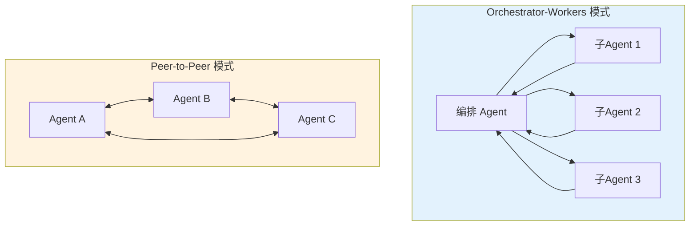

Orchestrator-Subagent 模式目前是主流做法：一个编排 Agent 负责全局规划和任务分发，多个子 Agent 并行或串行执行具体子任务，最后由编排 Agent 汇总输出；Peer-to-Peer 模式则是 Agent 之间平等对话、相互审查，更适合需要辩论或交叉验证的场景，比如代码审查、文章互校。

各主流 SDK 对"多 Agent"的抽象并不相同，选型时要看清它的核心原语：

| 框架 | 多 Agent 的核心原语 | 特点 |
|------|---------------------|------|
| OpenAI Agents SDK | Handoffs（交接）+ Guardrails | 交接链清晰，适合委派；并行协作较别扭 |
| Claude Agent SDK | Subagents + Hooks | 子 Agent 拥有独立上下文，擅长文件/系统操作类任务 |
| Google ADK | 层级 Agent 树 + Sequential/Parallel/Loop 工作流 Agent | 原生支持 A2A 协议 |
| LangGraph | 图组合（子图） | 控制力最强，需要自己设计状态 |

### 6.3 实证数据与代价：Anthropic Research 系统

Anthropic 公开了其 Research 功能的多 Agent 实现：主 Agent 负责规划并分派，多个子 Agent 并行检索。内部评测中，Claude Opus 4 作主 Agent、Claude Sonnet 4 作子 Agent 的组合，比单个 Opus 4 高出 90.2%（来源：Anthropic 工程博客《How we built our multi-agent research system》）。

| 维度 | 说明 |
|------|------|
| 提升来源 | 广度优先任务可并行探索多个方向，每个子 Agent 拥有独立上下文窗口 |
| Token 成本 | 据该博客披露，单 Agent 约为普通对话的 4 倍，多 Agent 约为 15 倍 |
| 适合 | 高度可并行、信息量超出单个上下文窗口、需要对接大量工具的任务 |
| 不适合 | 子任务强耦合、所有 Agent 需要共享同一份实时状态（协调成本会超过并行收益） |
| 容错与通信 | 单个 Agent 失败通常不拖垮整体，但 Agent 间通信开销高、协调失败可能卡死任务 |

> [!WARNING]
> 不要一上来就搞 Multi-Agent。业界对此存在明确争论：Cognition（Devin 团队）认为并行子 Agent 因上下文隔离而脆弱，Anthropic 则证明了广度优先研究任务中它的价值。两边并不矛盾，任务特性决定架构：共享状态的任务用单 Agent，彼此独立的任务才适合多 Agent。建议先用单Agent或简单 Workflow 跑通主流程，再根据实际失败模式决定是否升级。

## 7. Router + Skill 架构：分类路由与能力包组合

### 7.1 Router 的核心思想

Router（路由）架构解决的是"一个 Prompt 打天下"导致的性能妥协问题。它的思路是先对输入做分类，再导向一个专门的后续任务处理分支，这样能实现关注点分离，构建出更专业化的 Prompt；如果不做路由，针对某一类输入做的优化很可能会损害其他类型输入的表现（参考：Anthropic《Building Effective Agents》）。

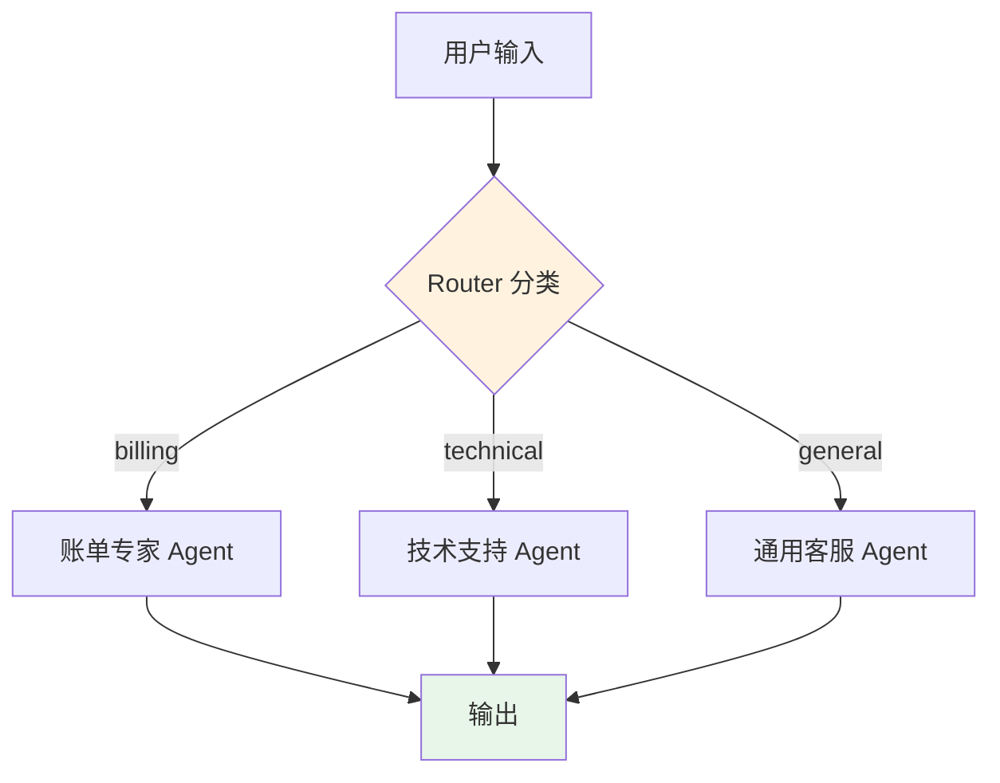

路由工作流非常适合类别差异明显、且分类能被准确处理的复杂任务，具体分类既可以用 LLM 完成，也可以用传统的分类模型或规则算法完成。一个常见的成本优化用法是：把简单常见的问题路由给体量更小、更经济的模型，把困难罕见的问题路由给能力更强的模型。

### 7.2 Skill：从提示词片段到开放标准

单纯的 Router 只解决了"分给谁"的问题，真正让每个分支变专业的是 Skill（能力包）机制。过去"Skill"是各家框架的私有概念，如今它有了统一标准：**Agent Skills**。Anthropic 在 2025 年 10 月随 Claude 推出 Skills，同年 12 月把格式发布为开放标准；2026 年 10 月 22 日，Anthropic 又把它的名称、GitHub 组织和 agentskills.io 域名捐赠给 Linux 基金会旗下的 Agentic AI Foundation（AAIF）。据 Anthropic 披露，已有 70 多个 Agent 平台（包括 ChatGPT、Cursor、GitHub Copilot、VS Code）接入。

一个 Skill 就是一个文件夹，核心是带 YAML 头的 `SKILL.md`：

```text
refund-policy/
├── SKILL.md        # 必需：元数据 + 操作指引
├── scripts/        # 可选：Agent 可以运行的脚本
├── references/     # 可选：按需读取的参考文档
└── assets/         # 可选：模板、数据文件
```

```markdown
---
name: refund-policy
description: 处理退款与扣费争议。当用户询问退款条件、重复扣费、发票补开时使用。
---

# 退款处理流程
1. 先查询订单状态，确认是否已发货；
2. 已发货且超过 7 天，转人工审核；
3. 重复扣费直接发起原路退回，并告知预计到账时间。
```

它的巧妙之处在于渐进式披露：Agent 启动时只加载每个 Skill 的名称和描述；当任务匹配时才读入 `SKILL.md` 正文（规范建议控制在约 5000 token 以内）；脚本和参考资料则在真正需要时才读取。

| 对比维度 | 纯 Prompt 堆砌 | Router + Agent Skills |
|----------|----------------|-----------------------|
| 可维护性 | 差，Prompt 越改越乱 | 好，Skill 是独立文件夹，可用 Git 版本管理 |
| 复用性 | 低，每个场景重写一遍 | 高，同一个 Skill 可跨 Agent、跨平台复用 |
| 加载方式 | 全部塞进上下文 | 渐进式按需加载，节省 Token |
| 扩展成本 | 新场景需要重写整个 Prompt | 新增一个文件夹即可 |

> [!TIP]
> Skill 的本质是把"过程性知识"从模型推理中剥离出来，变成可版本化、可测试的独立文件。如果你已经有一堆写在系统提示词里的操作手册，把它们改造成 Skill 是投入产出比最高的第一步。

### 7.3 Skill、MCP 与 AGENTS.md 如何分工

很多人会把 Skill 和 MCP 搞混。简单记忆：MCP 负责"连接"，Skill 负责"知识"。

| 标准 | 解决的问题 | 典型内容 |
|------|-----------|----------|
| MCP（Model Context Protocol） | Agent 如何连接外部工具和数据 | 数据库查询、文件系统、第三方 API |
| Agent Skills | Agent 如何掌握特定任务的方法 | 操作流程、领域规范、配套脚本 |
| AGENTS.md | Agent 如何理解某个项目的约定 | 构建命令、代码风格、目录结构 |

> [!NOTE]
> Spring AI 官方博客已有《Spring AI Agentic Patterns》系列，其中包含用 Agent Skills 做模块化能力的实践，说明这一标准已进入 Java 生态。


## 8. Blackboard 架构：共享黑板协同求解

### 8.1 核心机制

Blackboard（黑板）架构起源于早期的专家系统研究，其核心思想是创建一个所有模块都可读写的共享数据结构，通常称为"黑板"。不同的模块（称为知识源或代理）都能在这块黑板上读取和写入数据，每个模块根据黑板当前的数据状态自主决定是否需要动作，并在完成后更新黑板，从而一点点把系统状态推向最终目标。

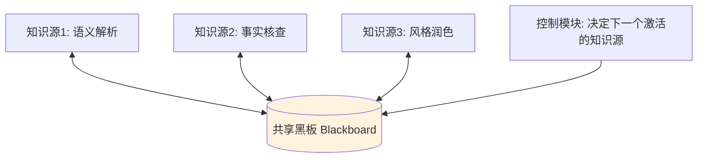

### 8.2 与 Multi-Agent 的核心区别

多Agent架构通常有明确的消息传递路径（谁调用谁），而 Blackboard 架构没有固定的调用顺序，各知识源根据黑板当前状态自主判断是否需要介入，这更适合那些尚未形成成熟确定解法、需要多个专业视角"轮流插话"的领域，例如语音识别、复杂文档理解等。

| 特点 | 说明 |
|------|------|
| 典型应用领域 | 网络信息检索、语音和模式识别、复杂决策支持 |
| 触发方式 | 数据驱动（黑板状态变化触发相关知识源） |
| 协调方式 | 无固定顺序，由控制模块动态决定激活哪个知识源 |
| 常见问题 | 全局状态设计复杂，调试和可观测性成本较高 |

### 8.3 今天还用得上吗？

> [!CAUTION]
> Blackboard 架构在 Agent 场景中并不算主流选择，因为它的可控性和可观测性弱于 Graph/Workflow 架构。它更适合探索性强、解空间不确定的科研类场景，企业级生产系统通常会优先考虑下一章介绍的 Graph/Workflow 架构。

不过"共享状态"这个核心思想并没有消失，只是换了形态。LangGraph 的 State、Deep Agents 提供的虚拟文件系统，都是让多个组件通过共同的数据空间协作，可以看作黑板思想在现代框架中的变体（这是本文的类比归纳，并非这些框架的官方表述）。区别在于，它们都加上了显式的节点、边和检查点，使流程可控、可回溯。


## 9. Graph/Workflow 架构：企业级生产主流

### 9.1 为什么图结构成为企业首选

2026 年的 Agent 基础设施有三个可观察的变化。第一，分层更清晰：LangChain 官方文档把工具分为框架（LangChain 的 `create_agent`）、运行时（LangGraph）和 harness（Deep Agents SDK）三层。第二，主流框架陆续 GA：LangGraph 1.0（2025 年 10 月）、Microsoft Agent Framework 1.0（2026 年 4 月初）、Spring AI 2.0（2026 年 6 月 12 日）。第三，协议标准化（见第 11 章）。在这一过程中，以有向图为核心的 Workflow 架构成为企业级落地的主流选择，代表框架是 LangGraph。

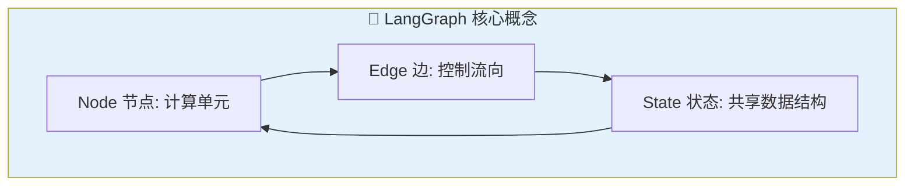

LangGraph 的核心哲学可以概括为"少抽象，多控制"：它的底层架构本质是一个有向图状态机，每个 Node 是一个计算单元（可以是 LLM 调用、工具执行或自定义逻辑），Edge 负责控制执行流向并支持条件分支，State 则是所有节点间共享的持久化数据结构，这种设计理念借鉴了 Google 的 Pregel 和 Apache Beam。LangGraph 1.0 的定位是"成熟而非新增功能"：图原语（状态、节点、边）和运行模型保持不变，持久化执行、流式输出、人工介入继续是一等公民。

| 层级 | 代表 | 适合什么 | 迁移提示 |
|------|------|----------|----------|
| Harness | Deep Agents SDK | 复杂多步任务，自带规划、虚拟文件系统、子 Agent、上下文压缩 | 基于 LangGraph 运行时构建 |
| 框架 | LangChain 1.0 `create_agent` | 快速构建 Agent，通过 middleware 定制 | 取代已弃用的 `langgraph.prebuilt.create_react_agent` |
| 运行时 | LangGraph 1.0 | 需要持久化执行、确定性与智能体混合编排 | 图原语 API 保持稳定 |

> [!IMPORTANT]
> 如果你的旧代码还在用 `create_react_agent`，应迁移到 LangChain 1.0 的 `create_agent`。它在 LangGraph 之上提供更简洁的接口，并通过 middleware 在模型调用前后、工具调用周围注入逻辑，例如摘要压缩、人工审批、提示缓存。

### 9.2 完整工作流程示例

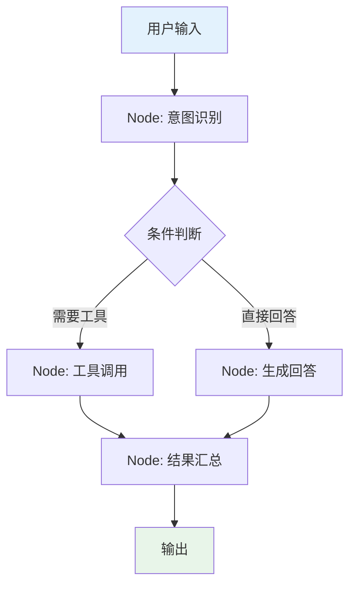

这种架构的价值在于：借助子图机制，可以把复杂系统拆分成一个个可独立测试的模块；内置的 Checkpointer 支持状态持久化，让 Agent 在服务重启后从中断处继续，还能实现"时间旅行"式调试——回溯到任意历史状态重新排查问题，这对企业级系统的可观测性和可维护性至关重要。

### 9.3 Microsoft Agent Framework 1.0

微软把 AutoGen 与 Semantic Kernel 合并为 Microsoft Agent Framework（MAF）。它于 2025 年 10 月公开预览，2026 年 2 月推出 RC，并在 2026 年 4 月初发布 1.0 GA，提供 .NET 与 Python 两个稳定的 SDK，并承诺长期支持（来源：微软 Agent Framework 团队与 Visual Studio Magazine 报道）。

| 要点 | 说明 |
|------|------|
| 定位 | Semantic Kernel 的企业级基础（会话状态、类型安全、中间件、遥测）+ AutoGen 的编排思想，以图工作流引擎为核心 |
| 协议支持 | 原生支持 MCP 与 A2A |
| 前代状态 | AutoGen 自 2025 年 10 月起进入维护模式；Semantic Kernel 继续发布修复版本，但新能力集中在 MAF |
| 语言覆盖 | .NET 与 Python 已 GA，Go 处于预览；未见官方 Java 版本，Java 团队请看第 10 章 |

> [!NOTE]
> 新项目应直接选择 MAF，而不是 AutoGen 或 Semantic Kernel。存量项目可参考官方迁移指南：AutoGen 项目建议在 2026 年内规划迁移，Semantic Kernel 项目可以按功能需要逐步迁移。


## 10. Java 生态：Spring AI 2.0 与 Agent 框架

### 10.1 Spring AI 2.0 带来了什么

Spring AI 1.0 在 2025 年 5 月 GA；2.0 于 2026 年 6 月 12 日 GA，要求 Spring Boot 4.x，基线为 Spring Framework 7。对已有 1.x 代码的团队，这是一次需要认真阅读升级说明的大版本。

| 变化点 | 说明 |
|--------|------|
| 平台基线 | Spring Boot 4 / Spring Framework 7；Java 最低 17，推荐 21+；Spring Boot 3.5 已于 2026-06-30 结束支持 |
| ChatClient | 明确为推荐入口，低层的 `ChatModel` 仅用于特殊场景 |
| Tool Calling | `@Tool` / `@ToolParam`（包 `org.springframework.ai.tool.annotation`）；工具循环由 `ChatClient` 自动注册的 `ToolCallingAdvisor` 执行，不再由 `ChatModel` 自己执行 |
| MCP | 注解 `@McpTool`、`@McpResource`、`@McpPrompt` 并入核心；Streamable HTTP 成为默认传输，SSE 视为废弃 |
| 会话记忆 | `MessageChatMemoryAdvisor` 每次调用必须带会话 ID（`ChatMemory.CONVERSATION_ID`）；旧的 `new InMemoryChatMemory()` 已被 Builder API 取代 |
| 底层依赖 | Jackson 3；API 全面使用 JSpecify 空值注解；OpenAI、Anthropic、Google 直接使用厂商官方 SDK |

> [!WARNING]
> 从 1.x 升级到 2.0 时，被重命名或移除的 API 不少。升级前先对照官方迁移说明，不要只改版本号。

### 10.2 其他 Java Agent 框架

| 框架 | 定位 | 适合场景 |
|------|------|----------|
| Spring AI Alibaba | 在 Spring AI 之上提供 Agent Framework（内置上下文工程与人工介入）和 Graph 运行时，支持 MCP / A2A / Nacos | 多智能体编排、复杂工作流、平台化治理 |
| AgentScope Java | Agentic 原生，以 ReAct、工具、记忆、多 Agent 为核心，支持 MCP 与 A2A | 自主智能体、分布式多 Agent |
| LangChain4j | 通用 Java LLM 框架，1.x 提供 `langchain4j-agentic` 模块，含 MCP、A2A 与编排模式 | 非 Spring 或 Quarkus 项目 |
| Google ADK（Java） | Google 的 Agent 开发套件，提供 Java 版本，原生 A2A | 与 Google Cloud / Gemini 深度结合 |

### 10.3 Java 团队怎么选

> [!TIP]
> 一个务实的起点：已有 Spring Boot 系统，从 Spring AI 2.0 的 `ChatClient` 开始，用 `@Tool` 接入业务能力；需要图编排与多 Agent 再叠加 Spring AI Alibaba 的 Graph；非 Spring 项目选 LangChain4j。第 13 章的示例都基于 Spring AI 2.0。

## 11. 协议与标准层：MCP、A2A 与 Agent Skills

### 11.1 三层协议的分工

2026 年的另一条明显主线，是 Agent 之间的"接口"被标准化了。可以把它理解为三层：

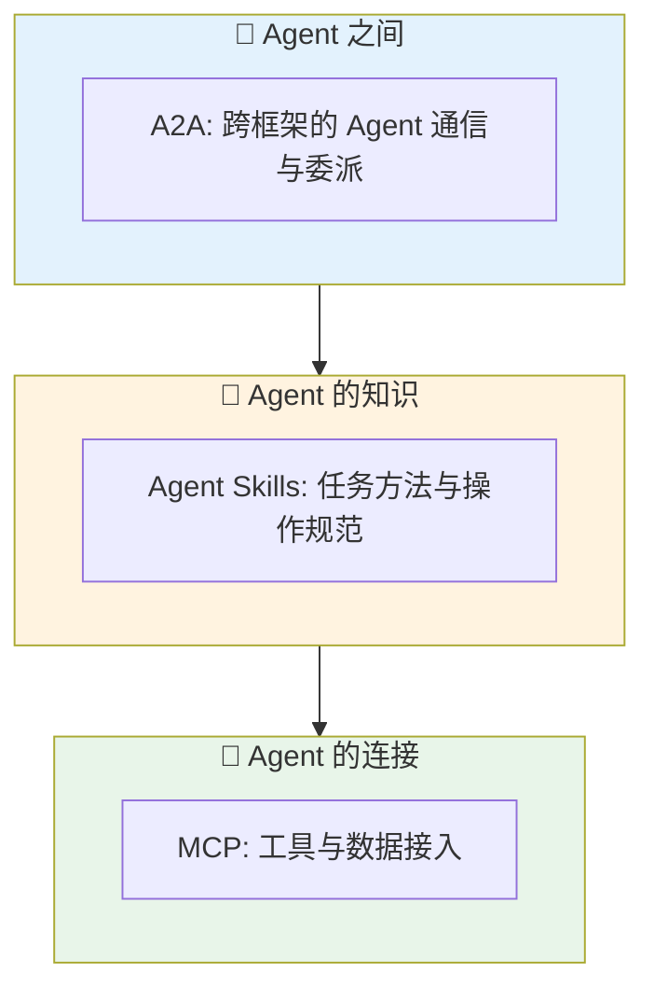

| 协议 | 起源 | 解决什么 | 对架构的影响 |
|------|------|----------|--------------|
| MCP | Anthropic | 统一工具与数据的接入方式 | 工具层可跨框架复用，换框架不必重写工具连接 |
| A2A | Google 发起 | 不同框架的 Agent 互相发现、委派任务（Agent Card 描述能力） | 多 Agent 可以跨团队、跨语言协作；已发布 1.0 规范，并有 Java 官方 SDK |
| Agent Skills | Anthropic | 可移植的任务知识包 | Router+Skill 架构有了通用的能力封装格式 |

### 11.2 AAIF：开放标准的中立归属

这些标准正在汇聚到同一个中立组织。2025 年 12 月，Linux 基金会成立 Agentic AI Foundation（AAIF），首批项目为 Anthropic 的 MCP、Block 的 goose 和 OpenAI 的 AGENTS.md。2026 年 10 月 22 日，Agent Skills、OpenAI 的 Open Responses、Hugging Face 的 OpenEnv 与阿里的 OpenSandbox 相继加入，基金会托管的项目增至十个，其中还包括 A2A、agentgateway 和 Agent Router。

| 时间 | 事件 |
|------|------|
| 2025-10 | Agent Skills 随 Claude 推出；LangChain / LangGraph 1.0 发布；MAF 公开预览，AutoGen 进入维护模式 |
| 2025-12 | AAIF 成立；Agent Skills 发布为开放标准 |
| 2026-04 | Microsoft Agent Framework 1.0 GA |
| 2026-06 | Spring AI 2.0 GA |
| 2026-10-22 | Agent Skills 捐赠给 AAIF |

### 11.3 对架构选型的影响

> [!IMPORTANT]
> 标准化意味着"锁定风险"降低：工具用 MCP 接入、能力用 Agent Skills 封装、跨 Agent 通信用 A2A，业务就不再绑死在某个框架上。选型时优先选择原生支持这些协议的框架，并把可复用的知识沉淀成 Skill，而不是写死在代码里。


## 12. 上下文工程与 Harness：2026 年的新主线

### 12.1 从提示词工程到上下文工程

前面所有架构，本质上都在回答同一个问题：每一步让模型看到什么？这就是上下文工程（Context Engineering）。它比"把提示词写好"范围更大，涵盖整个 Agent 循环中指令、历史、工具结果、检索内容与记忆的取舍。

| 维度 | 提示词工程 | 上下文工程 |
|------|-----------|-----------|
| 关注点 | 单条指令怎么写 | 每一步让模型看到什么 |
| 作用范围 | 一次调用 | 整个 Agent 循环及多 Agent 之间的信息流 |
| 典型手段 | 角色设定、示例、格式约束 | 压缩摘要、外部记忆、文件系统、子 Agent 隔离上下文、按需加载 Skill |
| 失败表现 | 回答跑偏 | 长任务"失忆"、上下文污染、Token 失控 |

Anthropic 的多 Agent 研究系统就是一个例子：它把计划等状态外置到记忆中，避免上下文窗口被写满后丢失早期计划。Spring AI Alibaba 的 Agent Framework 也把"内置上下文工程"作为卖点之一。

### 12.2 Harness：模型之外的一切

LangChain 文档用 Agent = Model + Harness 概括这一思路：模型是引擎，harness 是围绕引擎的整套外壳。

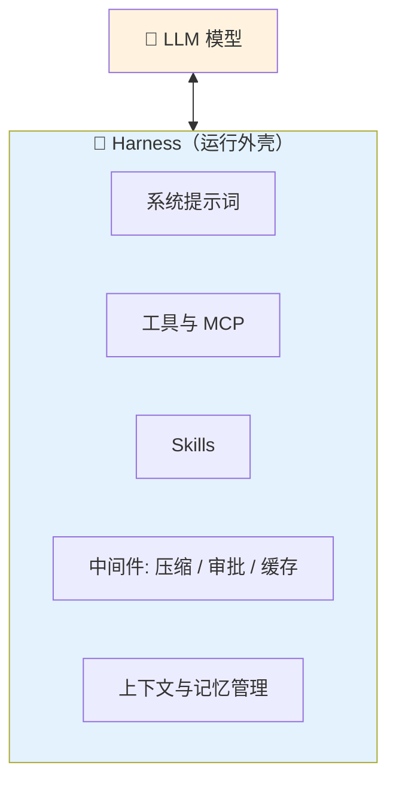

这也解释了为什么同一个模型，在不同产品里表现差异很大：差别往往来自 harness，而不是模型本身。

### 12.3 长任务：压缩还是重置

任务一旦跨越多个上下文窗口，就必须决定如何交接。Anthropic 的长任务实践提供了两种思路：

| 策略 | 做法 | 优缺点 |
|------|------|--------|
| 压缩（compaction） | 把历史总结后继续在同一上下文里工作 | 连续性好；但可能让模型对接近上限变得保守，影响长任务表现 |
| 重置 + 交接产物 | 清空上下文，用结构化的交接文件让下一个 Agent 接手 | 每轮都有干净的上下文；需要精心设计交接内容 |

LangChain 的 Deep Agents SDK 把这些做法打包成"开箱即用"的 harness：用 `TodoListMiddleware` 提供轻量规划，用虚拟文件系统存放中间产物，支持派生子 Agent，并带有自动上下文压缩。

> [!TIP]
> 做长任务 Agent 时，一个简单的起点是：让 Agent 把计划和进度写入文件，每次新上下文先读文件再继续。这正是"重置 + 交接产物"思路的最小实现。


## 13. 代码实现：基于 Spring AI 2.0 的三种架构示例

### 13.1 环境与依赖

以下示例基于 Spring AI 2.0.0 GA（要求 Spring Boot 4.x、Java 17+，推荐 21）。所有类放在同一个包 `demo.agent` 下，方便组件扫描。

```xml
<!-- pom.xml 关键片段：Spring Boot 4.x + Spring AI 2.0.0 -->
<parent>
    <groupId>org.springframework.boot</groupId>
    <artifactId>spring-boot-starter-parent</artifactId>
    <!-- 请使用当前可用的 4.x 最新补丁版本 -->
    <version>4.0.6</version>
</parent>

<properties>
    <java.version>21</java.version>
</properties>

<dependencyManagement>
    <dependencies>
        <!-- 用 BOM 统一管理 Spring AI 版本 -->
        <dependency>
            <groupId>org.springframework.ai</groupId>
            <artifactId>spring-ai-bom</artifactId>
            <version>2.0.0</version>
            <type>pom</type>
            <scope>import</scope>
        </dependency>
    </dependencies>
</dependencyManagement>

<dependencies>
    <!-- 换成 Anthropic / Google 只需替换 starter，业务代码不变 -->
    <dependency>
        <groupId>org.springframework.ai</groupId>
        <artifactId>spring-ai-starter-model-openai</artifactId>
    </dependency>
</dependencies>
```

```yaml
# application.yml
spring:
  ai:
    openai:
      api-key: ${OPENAI_API_KEY}   # 从环境变量读取，避免硬编码密钥
      chat:
        options:
          model: gpt-5-mini        # 示例模型名，请替换为你账号可用的模型
```

> [!NOTE]
> 本文代码依据 Spring AI 2.0.0 GA 的公开资料与官方 API 命名编写，未在本地编译运行。`ChatMemory`、`MessageChatMemoryAdvisor` 的包路径若与你的版本有出入，以官方 Javadoc 为准。

### 13.2 Router 架构：结构化输出做分类

早期常见写法是用 `contains("扣费")` 这类关键词匹配分类，漏判很多。更稳妥的做法是让模型直接返回结构化分类结果，并设置置信度阈值兜底。

```java
// RouterAgent.java
// 说明：用 ChatClient 的结构化输出做路由分类，再把请求分发给对应"Skill"提示词
package demo.agent;

import java.util.Map;
import org.springframework.ai.chat.client.ChatClient;
import org.springframework.stereotype.Component;

@Component
public class RouterAgent {

    public enum Category { BILLING, TECHNICAL, GENERAL }

    // 分类结果：类别 + 置信度，由 .entity() 直接映射为 Java record
    public record Route(Category category, double confidence) {}

    // 路由表：分类 -> 专属系统提示词（生产中可替换为 Agent Skills）
    private static final Map<Category, String> SKILLS = Map.of(
            Category.BILLING, "你是账单专家，只处理扣费、退款、发票问题。",
            Category.TECHNICAL, "你是技术支持工程师，只处理报错、崩溃、性能问题。",
            Category.GENERAL, "你是通用客服，处理一般性咨询。");

    private final ChatClient chatClient;

    public RouterAgent(ChatClient.Builder builder) {
        this.chatClient = builder.build();
    }

    public String handle(String userInput) {
        // 第一步：分类（生产中可改用更小、更便宜的模型）
        Route route = chatClient.prompt()
                .system("你是路由器。把用户问题分类为 BILLING、TECHNICAL 或 GENERAL，并给出 0 到 1 的置信度。")
                .user(userInput)
                .call()
                .entity(Route.class);

        // 第二步：低置信度时回退到通用分支，避免错误路由
        Category target = route.confidence() >= 0.6 ? route.category() : Category.GENERAL;

        // 第三步：带着专属系统提示词调用模型
        return chatClient.prompt()
                .system(SKILLS.get(target))
                .user(userInput)
                .call()
                .content();
    }
}
```

### 13.3 ReAct 架构：原生 Tool Calling + 会话记忆

这里不再手写 `while` 循环和字符串解析。`@Tool` 声明工具，`ChatClient` 内部的 `ToolCallingAdvisor` 自动完成"模型决定调用 → 执行工具 → 回传观察 → 再次推理"的 ReAct 循环。

```java
// OrderTools.java
// 说明：用 @Tool 声明模型可以调用的工具，description 决定模型何时调用它
package demo.agent;

import org.springframework.ai.tool.annotation.Tool;
import org.springframework.ai.tool.annotation.ToolParam;
import org.springframework.stereotype.Service;

@Service
public class OrderTools {

    @Tool(description = "根据订单号查询订单状态与物流单号")
    public String queryOrder(@ToolParam(description = "订单号，例如 A1001") String orderId) {
        // 演示数据：真实场景在这里调用订单服务
        return "订单 " + orderId + "：已发货，物流单号 SF123456";
    }

    @Tool(description = "根据物流单号查询最新物流节点")
    public String trackShipment(@ToolParam(description = "物流单号，例如 SF123456") String trackingNo) {
        // 演示数据：真实场景在这里调用物流接口
        return "物流 " + trackingNo + "：已到达杭州转运中心，预计明天送达";
    }
}
```

```java
// ReActAgent.java
// 说明：ReAct Agent = 系统提示词 + 工具 + 会话记忆，循环由框架托管
package demo.agent;

import org.springframework.ai.chat.client.ChatClient;
import org.springframework.ai.chat.client.advisor.MessageChatMemoryAdvisor;
import org.springframework.ai.chat.memory.ChatMemory;
import org.springframework.stereotype.Component;

@Component
public class ReActAgent {

    private final ChatClient chatClient;

    // ChatMemory 由 Spring Boot 自动配置（默认内存窗口记忆）
    public ReActAgent(ChatClient.Builder builder, OrderTools tools, ChatMemory chatMemory) {
        this.chatClient = builder
                .defaultSystem("你是售后 Agent。先判断需要哪些信息，必要时调用工具；"
                        + "拿到工具返回的结果后再决定下一步，信息足够时直接给出最终答案。")
                .defaultTools(tools) // 注册工具时传入 Bean，而不是方法名字符串
                .defaultAdvisors(MessageChatMemoryAdvisor.builder(chatMemory).build())
                .build();
    }

    public String run(String conversationId, String task) {
        return chatClient.prompt()
                .user(task)
                // 2.0 起，记忆 Advisor 每次调用都必须带会话 ID，用于隔离不同会话
                .advisors(a -> a.param(ChatMemory.CONVERSATION_ID, conversationId))
                .call()
                .content();
    }
}
```

问"订单 A1001 的物流到哪了"时，模型会先调用 `queryOrder` 拿到物流单号，再调用 `trackShipment`，这就是一次两步的 ReAct 循环。


### 13.4 Reflection 架构与启动类

生成者与评估者分离、评估结果结构化、轮数有上限，是 Reflection 落地的三个要点。

```java
// ReflectionAgent.java
// 说明：生成 -> 评估 -> 根据意见改写，最多反思 MAX_ROUNDS 轮
package demo.agent;

import org.springframework.ai.chat.client.ChatClient;
import org.springframework.stereotype.Component;

@Component
public class ReflectionAgent {

    // 评估结果：是否通过 + 具体修改意见
    public record Review(boolean passed, String feedback) {}

    private static final int MAX_ROUNDS = 3; // 防止无限反思，控制成本

    private final ChatClient chatClient;

    public ReflectionAgent(ChatClient.Builder builder) {
        this.chatClient = builder.build();
    }

    public String write(String task) {
        // 第一步：生成初稿（生成者）
        String draft = chatClient.prompt()
                .system("你是资深技术写作者，写作准确、简洁。")
                .user(task)
                .call()
                .content();

        for (int round = 1; round <= MAX_ROUNDS; round++) {
            // 第二步：独立评估（评估者），标准必须具体、可检查
            Review review = chatClient.prompt()
                    .system("你是严格的审稿人。检查：1) 事实是否准确；2) 是否紧扣任务；3) 有无冗余。"
                            + "全部满足才算通过，否则给出具体修改意见。")
                    .user("任务：" + task + "\n草稿：" + draft)
                    .call()
                    .entity(Review.class);

            if (review.passed()) {
                return draft; // 评估通过，提前结束
            }

            // 第三步：带着评估意见改写
            draft = chatClient.prompt()
                    .system("你是资深技术写作者。请根据审稿意见改写草稿，只输出改写后的正文。")
                    .user("任务：" + task + "\n上一版草稿：" + draft + "\n审稿意见：" + review.feedback())
                    .call()
                    .content();
        }
        return draft; // 达到轮数上限，返回最新版本
    }
}
```

```java
// AgentDemoApplication.java
// 说明：启动类，依次演示三种架构
package demo.agent;

import org.springframework.boot.CommandLineRunner;
import org.springframework.boot.SpringApplication;
import org.springframework.boot.autoconfigure.SpringBootApplication;
import org.springframework.context.annotation.Bean;

@SpringBootApplication
public class AgentDemoApplication {

    public static void main(String[] args) {
        SpringApplication.run(AgentDemoApplication.class, args);
    }

    @Bean
    CommandLineRunner demo(RouterAgent router, ReActAgent react, ReflectionAgent reflection) {
        return args -> {
            // Router：分类后路由到账单专家
            System.out.println(router.handle("我被重复扣费了，想申请退款"));
            // ReAct：自动调用两个工具完成多步任务
            System.out.println(react.run("session-1", "帮我查一下订单 A1001 的物流到哪了"));
            // Reflection：生成 -> 评估 -> 改写
            System.out.println(reflection.write("用 200 字解释什么是 ReAct 架构"));
        };
    }
}
```

## 14. 架构横向对比与选型建议

### 14.1 八大架构总览对比

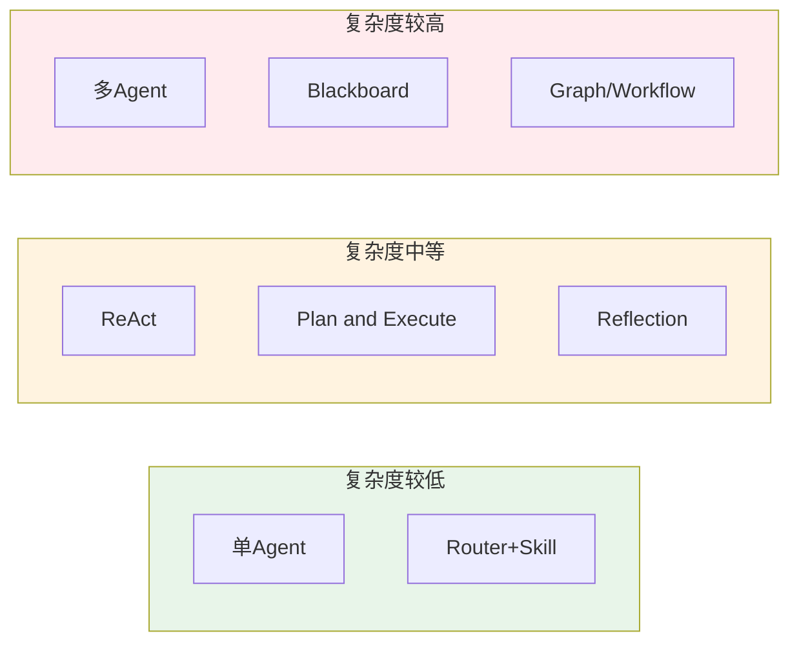

| 架构 | 核心特点 | 最佳适用场景 | 主要局限 |
|------|----------|--------------|----------|
| 单Agent | 一个 LLM + 工具集独立完成任务 | 客服问答、单文档处理 | 无法应对多角色分工需求 |
| ReAct | 思考-行动-观察循环，动态推理 | 需要实时信息、动态决策的任务 | 调试难、Token 消耗较高 |
| Plan & Execute | 先规划后执行，结构化流程 | 步骤明确的长期复杂任务 | 缺乏动态调整能力 |
| Reflection | 生成-评估-反思-重试 | 有客观反馈信号的代码、写作、分析 | 无可验证信号时易空转，成本随轮数上升 |
| 多Agent | 多角色协作，编排或对等模式 | 可并行的广度优先任务 | Token 成本高（约 15 倍），协调失败风险 |
| Router + Skill | 分类路由 + 能力包复用 | 输入类别清晰、需要成本优化 | 分类不准会导致次优路由 |
| Blackboard | 共享数据结构，数据驱动协作 | 解空间不确定的探索性问题 | 全局状态设计复杂，难调试 |
| Graph/Workflow | 有向图状态机，确定性编排 | 企业级、需要可观测和可回溯 | 学习曲线陡峭，需要自行设计状态 |

> [!IMPORTANT]
> 选型的第一原则不是"哪个架构最先进"，而是"任务的可预测性有多高"。Anthropic 给出的原始判断依据是：构建 LLM 应用时应优先寻找尽可能简单的解决方案，只有在确有必要时才增加复杂度——这甚至可能意味着完全不需要构建 Agent 系统。


### 14.2 框架与写法的选型对比

| 框架/写法 | 上手难度 | 灵活性 | 适合场景 |
|-----------|----------|--------|----------|
| Spring AI 2.0（本文示例） | ⭐⭐ | ⭐⭐⭐ | Spring Boot 团队，快速接入工具、记忆、MCP |
| Spring AI Alibaba / AgentScope Java | ⭐⭐⭐ | ⭐⭐⭐⭐ | Java 团队的多 Agent 与图编排 |
| LangChain 1.0 `create_agent` | ⭐⭐ | ⭐⭐⭐⭐ | Python/TS 团队，快速搭建并用 middleware 定制 |
| LangGraph 1.0 | ⭐⭐⭐⭐ | ⭐⭐⭐⭐⭐ | 需要持久化执行、人工介入的复杂系统 |
| Microsoft Agent Framework 1.0 | ⭐⭐⭐ | ⭐⭐⭐⭐ | .NET / Python 团队，Azure 生态 |


### 14.3 常见问题与解决方案

| 问题 | 原因 | 解决方案 |
|------|------|----------|
| Agent 长任务中途"失忆" | 未做长短记忆分离 | 短期用滑动窗口，长期把计划与进度外置到文件或向量索引；必要时重置上下文并交接 |
| 多Agent 协作卡死 | 缺乏统一的状态管理和超时机制 | 引入 Orchestrator 统一调度，设置每个子任务的超时/重试策略 |
| Router 分类错误导致体验差 | 分类逻辑过于简单（纯关键词匹配） | 用结构化输出做分类，设置置信度阈值，低置信度回退或人工兜底 |
| 图状态机调试困难 | 状态设计过于复杂，节点职责不清 | 用 Checkpoint 机制回溯历史状态，保持每个节点单一职责 |
| Token 费用失控 | 多 Agent 并行、工具循环无上限 | 设置轮数与预算上限；简单任务路由给小模型；监控 Token 指标 |
| 工具/Skill 加载过多 | 一次性把全部能力塞进上下文 | 用渐进式加载，按任务匹配再读取正文 |

> [!WARNING]
> 无论选择哪种架构，都要"评估先行"：Agent 具有不确定性，同样的输入两次运行可能得到不同结果，没有评估体系的项目几乎不可能真正上线。Anthropic 的多 Agent 经验同样强调自动化评估与人工测试相结合。上线前务必搭建针对性的评估集，并给每个工具调用设置权限边界。

## 15. 总结

### 15.1 核心概念速查

| 核心概念 | 一句话解释 |
|---------|-----------|
| 单Agent架构 | 一个 LLM 加工具集，独立闭环完成任务 |
| ReAct | 思考、行动、观察三步循环；现代实现靠原生 Tool Calling |
| Plan & Execute | 先制定完整计划，再按步骤顺序执行 |
| Reflection | 生成、评估、反思、重试，必须有轮数上限和可验证的评估信号 |
| 多Agent架构 | 多个专业角色协作，适合可并行的广度优先任务，但 Token 成本高 |
| Router + Skill | 先分类路由，再用 Agent Skills 渐进加载专业能力 |
| Blackboard | 共享数据结构，各知识源自主判断何时介入 |
| Graph/Workflow | 有向图状态机，节点+边+状态实现确定性编排与持久化执行 |
| MCP / A2A / Agent Skills | 工具连接、Agent 通信、任务知识三层开放标准 |
| 上下文工程 / Harness | 决定每一步让模型看到什么，以及模型之外的整套运行外壳 |

### 15.2 学习路径建议

> [!TIP]
> **学习路径建议**：
> 1. 先用单Agent或简单 Router 跑通最小可用版本（如第 13 章的 Spring AI 示例），验证业务假设
> 2. 遇到多步骤、需要纠错的场景，引入 ReAct 或 Plan & Execute；有客观验证信号时再加 Reflection
> 3. 把写在提示词里的操作手册沉淀为 Agent Skills，把外部系统用 MCP 接入
> 4. 当单一模型角色混乱，且任务可以并行时，再升级为多Agent协作
> 5. 需要企业级可观测性、状态持久化和人工介入时，迁移到 Graph/Workflow 架构（如 LangGraph、Microsoft Agent Framework）
> 6. 全程搭建评估集，并持续优化上下文管理


## 16. 参考资料

### 核心论文

| 论文 | 作者/机构 | 年份 | 主要贡献 |
|------|-----------|------|----------|
| [ReAct: Synergizing Reasoning and Acting in Language Models](https://arxiv.org/abs/2210.03629)（arXiv:2210.03629） | Shunyu Yao 等，Princeton/Google Research | 2022 | 提出推理与行动交织的核心范式，被公认为现代 Agentic LLM 的奠基性工作 |
| [Reflexion: Language Agents with Verbal Reinforcement Learning](https://arxiv.org/abs/2303.11366)（arXiv:2303.11366） | Noah Shinn 等 | 2023 | 用文字形式的自我反思与情景记忆改进 Agent，无需更新模型权重（NeurIPS 2023） |
| [Plan-and-Solve Prompting](https://arxiv.org/abs/2305.04091)（arXiv:2305.04091） | Lei Wang 等 | 2023 | 先制定计划再执行的提示方法，减少 Zero-shot CoT 的漏步错误（ACL 2023） |

### 推荐资源

- [Building Effective AI Agents - Anthropic 官方工程博客](https://www.anthropic.com/engineering/building-effective-agents)
- [How we built our multi-agent research system - Anthropic 工程博客](https://www.anthropic.com/engineering/multi-agent-research-system)
- [Donating Agent Skills to the Agentic AI Foundation - Anthropic](https://www.anthropic.com/news/donating-agent-skills-to-the-agentic-ai-foundation)
- [LangChain v1 发布说明](https://docs.langchain.com/oss/python/releases/langchain-v1)
- [LangGraph v1 发布说明](https://docs.langchain.com/oss/python/releases/langgraph-v1)
- [Deep Agents 概览 - LangChain 文档](https://docs.langchain.com/oss/python/deepagents/overview)
- [Microsoft Agent Framework at BUILD 2026 - 微软开发者博客](https://devblogs.microsoft.com/agent-framework/microsoft-agent-framework-at-build-2026-announce/)
- [Microsoft Ships Production-Ready Agent Framework 1.0 - Visual Studio Magazine](https://visualstudiomagazine.com/articles/2026/04/06/microsoft-ships-production-ready-agent-framework-1-0-for-net-and-python.aspx)
- [Spring AI 2.0 Goes GA - Visual Studio Magazine](https://visualstudiomagazine.com/articles/2026/06/29/spring-ai-2-0-goes-ga-giving-java-developers-a-more-mature-ai-app-stack.aspx)
- [Spring AI 2.0: AI in the Java Stack - inovex](https://www.inovex.de/en/blog/spring-ai-2-0-ai-in-the-java-stack-without-having-to-go-through-python/)
- [Building Effective Agents - Spring AI 官方文档](https://docs.spring.io/spring-ai/reference/api/effective-agents.html)
- [Spring AI Alibaba - GitHub](https://github.com/alibaba/spring-ai-alibaba)
- [AgentScope Java 文档](https://java.agentscope.io/zh/intro.html)
- [Anthropic Designs Three-Agent Harness - InfoQ](https://infoq.com/news/2026/04/anthropic-three-agent-harness-ai/)
