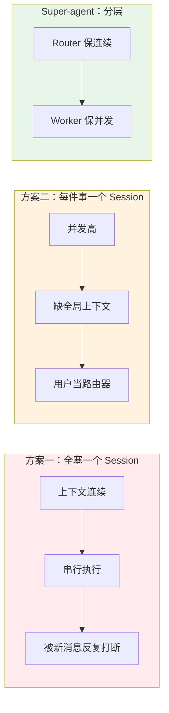
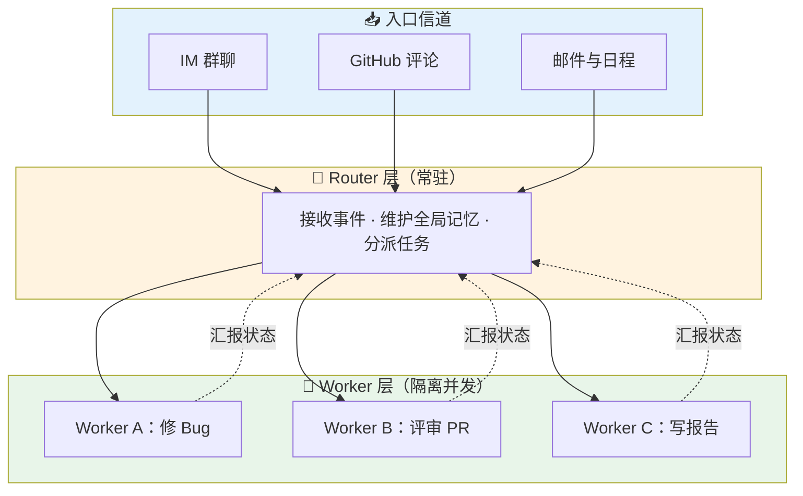
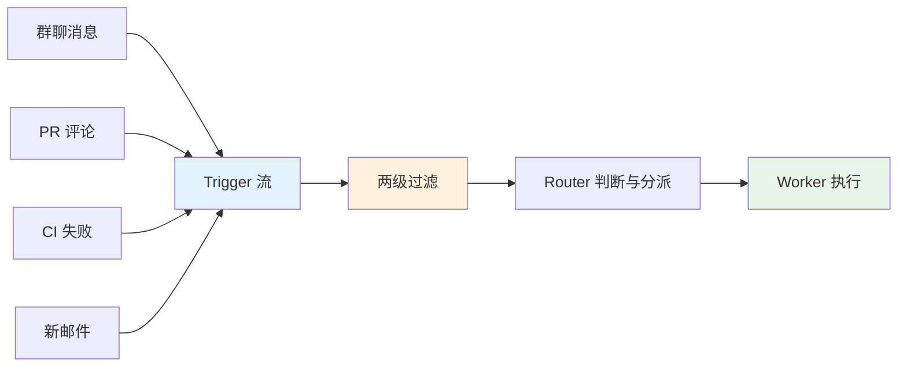
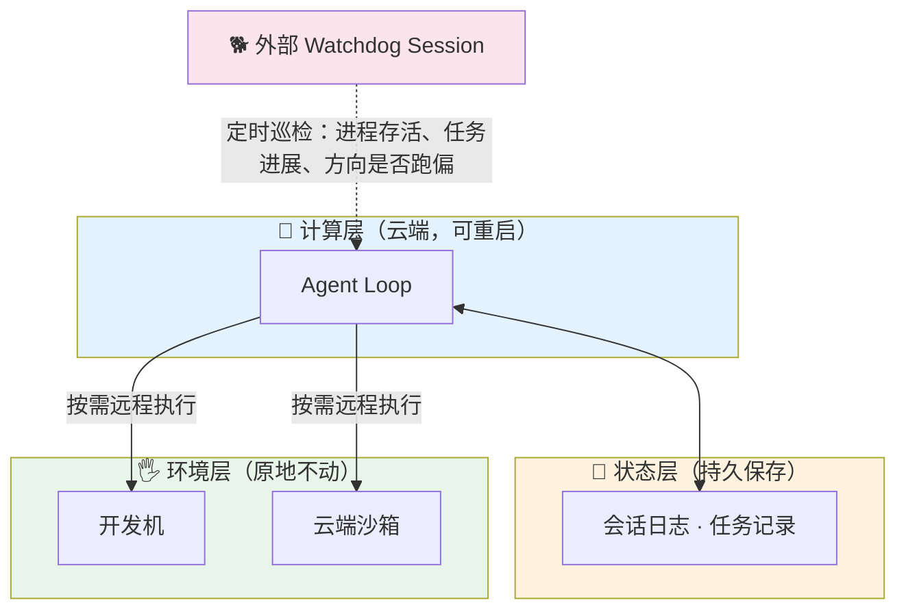
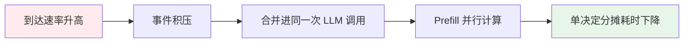

> Super-agent 是一种持续在线、能并行推进多项任务、会主动发现工作并在不必要时保持安静的 Agent 形态；它的核心做法是用"Router 分派 + Worker 执行"的双层架构，把会话管理从用户手里接过来。读完本文，你能理解它为什么出现、由哪五个模块构成、怎样落地，以及它的代价和边界。
>
> 📌 **核心资料**：[dsh-superagent-prototype](https://github.com/deepseek-ai/dsh-superagent-prototype)（DeepSeek Harness 团队 2026 年 10 月 31 日发布的研究原型，MIT 许可证）
>
> 📌 **适合人群**：AI 应用开发者、后端工程师、关注 Agent 产品形态的技术负责人


<MindMapFloat title="Super-agent 知识图谱">

```mindmap-data
# Super-agent
## 为什么需要
- 瓶颈从模型能力转向人的注意力
- 一个人只能盯 3 到 5 个活跃 Session
- 单 Session 与多独立 Session 各有死穴
## 核心架构
- Router 只分派、不执行
- Worker 隔离执行、不直接对人说话
- Session 成为系统内部细节
## 主动机制
- 环境事件即 Trigger
- 程序快筛加模型慢判
- 订阅直通与链式召回
- 投机执行：静默复现并修复
## 持久与交互
- 异步 ReAct：start 与 stop
- 不同信道不同说话方式
- 存算分离与外部 Watchdog
## 落地与边界
- 先写规则再放权
- 用 token 换时间与注意力
- 四个开放问题
```

</MindMapFloat>

## 关于本文档

本文基于 DeepSeek Harness 团队 2026 年 10 月 31 日发布的《Super-agent 设计探索：迈向更自主的 Agent 系统》及其开源原型，结合 Anthropic 同期的 Claude Duet 与 Managed Agents 设计，梳理 Super-agent 的设计动机、架构、机制与落地要点。文中不含演示代码，重点放在"为什么这样设计"和"落地时怎么取舍"。

- ✅ 理解为什么 Agent 的瓶颈正在从模型转向人的注意力
- ✅ 掌握双层架构、事件驱动、存算分离、Watchdog 五个模块
- ✅ 看懂"两级过滤""订阅直通""Inline & Spill""投机执行"等关键机制
- ✅ 获得一份可直接照着做的落地设计清单与避坑表
- ✅ 了解初步实验数据、与 Claude Duet 的差异，以及尚未解决的问题

## 1. 为什么单个 Agent 会话不够用了

### 1.1 瓶颈从模型转向了人的注意力

想象你同时让 Agent 修一个 Bug、写一份周报、评审一个 PR。过去一年，Coding Agent 已经证明模型能独立完成单个复杂任务，人越来越少介入执行细节，角色上移到决策与验收。但主流 Agent 仍以单个 Session（会话）为基本单位，每个任务一个 Session，Session 之间互不相通。于是真正知道"全局"的只有你自己。

DeepSeek 团队观察到，一个人通常只能同时跟进 3 到 5 个活跃 Session。再往上，切换和维护上下文的成本就会吞掉 Agent 带来的效率。也就是说，限制生产力的已经不只是"Agent 够不够聪明"，而是"你能同时盯住几个 Agent"。

| 维度 | 传统单 Session Agent | 暴露的问题 |
|------|---------------------|-----------|
| 任务组织单位 | 每次对话一个 Session | Session 间上下文不互通 |
| 全局视角 | 只在用户脑中 | 用户成为"人肉路由器" |
| 并行能力 | 取决于用户开几个窗口 | 人最多同时跟 3 到 5 个 |
| 设备依赖 | 本地设备休眠即停 | 无法 24 小时在线 |

> [!NOTE]
> "Session 由用户手动管理"在很大程度上是底层 LLM API 留下的设计惯性，并不是天然正确的产品形态。用户真正关心的是任务有没有办完，而不是会话怎么切。


### 1.2 两个"显而易见"的方案为什么都不行

要让 Agent 同时处理多件事，直觉上有两条路：全部塞进一个 Session，或者每件事开一个独立 Session。前者上下文最连续，但单个 ReAct 循环是串行的，吞吐低，几件事的细节还容易混在一起；后者吞吐最高，但缺少全局上下文，结果割裂，交互混乱。这是"连续性"与"吞吐量"之间的根本权衡。



DeepSeek 在对比实验中也印证了这一点：带 Subagent 工具的单 Session 方案受提示词影响很大。在中性提示下，5 次运行里一次都没有调用 Subagent，全部在主 Session 里硬扛，不断被新消息打断，p95 完成时间达到 29.5 分钟。

### 1.3 Super-agent 的四个基础特征

DeepSeek 把这种新形态称为 Super-agent，并归纳出四个基础特征。可以把它类比成一位"记忆力超群、全天在线、不摸鱼的同事"：你交代过的事他记得，在群聊、邮件、GitHub 里都能接着干，而且看到问题不用你点名就会先去看。

| 特征 | 含义 | 生活类比 |
|------|------|----------|
| 连续 | 在 IM、GitHub 评论等不同渠道面对的始终是同一个 Agent | 同一位同事，不管你在哪个群找他 |
| 高效 | 并行处理多个复杂任务，不必等上一个完成 | 同事手上有多个项目并行 |
| 主动 | 持续观察环境事件，自行推进值得做的事 | 看到有人报 Bug，不等点名先去看 |
| 持久 | 始终在线，长期运行中出异常能自动恢复 | 24 小时不下班，出状况有人巡店 |

> [!IMPORTANT]
> 单个 ReAct 循环无法同时满足这四个特征，必须有一套专门的底层架构。DeepSeek 的判断是：只要目标是"持续在线、并发响应环境事件"，不论个人助手还是研发场景，底层很可能收敛到相近的架构。


## 2. 双层架构：Router 负责分派，Worker 负责干活

### 2.1 Router：只分派、不执行

双层架构把"维护全局连续性"和"高并发执行"拆成两层。Router 层常驻在线，承接所有入口的人类交互，汇总跨任务的信息与决策，相当于项目主管；它在设计上不直接执行任务，甚至可以不配备 Bash 工具，以免自己变成性能瓶颈。



一个自然的疑问是：单个常驻 Router 会不会成为瓶颈？DeepSeek 的回答是批处理。Router 每步通常是"长输入、短输出"，上一轮推理期间到达的事件会积压，下一轮被合并进同一次 LLM 调用，在 Prefill 阶段并行计算，单次耗时增长远慢于批大小。所以积压越多，单个决定分摊的推理时间越低。

> [!TIP]
> 团队的实践发现 Router 的任务往往没有想象中复杂，用较轻量的模型就能兼顾速度与效果；而 Worker 直接决定结果质量，应当配置能力最强的模型。

### 2.2 Worker：隔离执行、不直接对人说话

每个 Worker 只领一项任务，挂载完整的执行工具，在独立上下文里专注完成。Worker 的推理过程和工具调用不会直接输出到外部信道，而是把状态和结果汇报给 Router，由 Router 统一对外回复，避免多个会话各说各话。

Worker 之间通常不需要点对点通信。多个 Worker 的冲突往往发生在同一个 Pull Request 这样的共享环境里，只要它们都订阅了对应的 Thread，就会收到相同的事件通知，有机会自己发现并化解冲突；少数跨任务协同才由 Router 中转。

| 对比项 | Router 层 | Worker 层 |
|--------|-----------|-----------|
| 职责 | 对外交互、全局记忆、任务分派 | 单个任务的完整执行 |
| 工具 | 轻量，可不带 Bash | 完整执行工具 |
| 模型选择 | 较轻量模型即可 | 配置最强模型 |
| 上下文 | 全局、跨任务 | 隔离、单任务 |
| 是否直接对人说话 | 是（统一出口） | 否（只向 Router 汇报） |

### 2.3 它与 Agent Team、Subagent 有什么不同

很多人第一反应是："这不就是主 Agent 带几个子 Agent 吗？"表面相似，侧重点不同。常见的 Agent Team 用于单个复杂任务内部的步骤拆解，子步骤耦合紧，Team Lead 要深入理解任务细节、规划子任务并高频协调，推理负担很重。Super-agent 的 Router 只处理任务之间的高层关联与分派，不介入单任务内部拆解。

DeepSeek 也指出，如果用提示词约束一个 Agent Team 的主会话"不亲自干活，只负责对外交互和分派"，也可以视为这种双层架构。Worker 内部同样可以再创建 Subagent，这些对 Router 保持透明。

| 维度 | Agent Team / 主 Agent + Subagent | Super-agent 双层架构 |
|------|-------------------------------|---------------------|
| 拆分对象 | 单个任务内部的步骤 | 彼此独立的多个任务 |
| 主节点负担 | 重：理解细节、规划、高频协调 | 轻：只决定"交给谁" |
| 子节点耦合 | 紧，每步需协调 | 松，上下文隔离 |
| 冲突发现 | 靠主节点协调 | 靠订阅同一 Thread |

> [!NOTE]
> Anthropic 近期强调的"单个 Agent 往往比一堆子 Agent 更高效"，针对的是单任务内部的拆分；Super-agent 解决的是"多个独立任务如何并行且不互相污染"，两者并不矛盾。


## 3. 事件驱动：不等指令，让 Agent 自己发现活

### 3.1 环境事件就是输入：Trigger 与 Thread

要让 Agent 主动，先要改变驱动方式：输入不再只是人逐条键入的提示词，而是环境里的半结构化事件。群聊消息、邮件、日程提醒、代码评审评论、CI 结果，统称为 Trigger。同一个 PR、同一个 IM 话题或同一封往来邮件下的连续事件，构成一条 Thread。



### 3.2 两级过滤：程序先快筛，模型再慢判

真实群聊是"高噪音、低触发率"的，绝大多数消息和 Agent 无关。如果每条都让大模型读一遍，又慢又贵。DeepSeek 借用了计算机系统里的 Fast Path / Slow Path 思想：确定性的判断固化成代码走快路径，需要语义理解的判断交给模型走慢路径。

| 层级 | 做什么 | 典型规则 | 好处 |
|------|--------|----------|------|
| 程序层（Fast Path） | 按来源、群组、用户或机器人白名单做准入 | "仅响应明确请求""作为候选""直接忽略" | 调用模型前滤掉大部分噪音 |
| 语义层（Slow Path） | 由 LLM 按提示词写成的策略判断是否需要行动 | "这是随口吐槽还是真问题" | 用自然语言就能改策略 |

语义层还有一个产品价值：它是面向人的自然语言扩展点。团队想调整"哪些事该主动管"，改一句提示词即可，不用改代码。

### 3.3 订阅直通与链式召回

如果已分配任务的每个后续事件都要经 Router 转发，Router 依然会被压垮。解法是订阅与直通：Router 为某个 Thread 的初始事件创建 Worker 后，该 Worker 直接订阅这个 Thread，后续同一 Thread 的事件由程序直接送达，不再经过 Router；新事件超出任务范围时，Worker 也可以取消订阅，交回 Router 重新分派。Thread 与 Worker 是多对多关系，一个 Worker 可订阅多个 Thread，一个 Thread 也可被多个 Worker 订阅。

事件进入会话后，还要解决"注入多少上下文"。DeepSeek 把上下文窗口当作 Cache 管理：Inline 是把近期很可能用到的信息直接内联，省一次工具调用；Spill 是把过长或低频的内容留在窗口外，只保留摘要和引用，需要时再读。系统给 Trigger、Thread、Worker Session 都赋予唯一 ID，并在注入时内联关联对象的 ID，模型就能顺着引用逐跳召回上下文，这就是链式召回。

| 操作 | 含义 | 例子 |
|------|------|------|
| Inline | 把很可能用到的信息直接放进上下文 | 消息前 50 字、相邻消息、所回复的消息 |
| Spill | 超限内容留在窗口外，只留引用 | 长内容截断并保留续读入口 |
| 链式召回 | 沿对象 ID 逐跳展开 | 消息 → Thread → Worker → 另一个评审 Thread |

> [!TIP]
> 文章的一句话值得记住：浪费上下文窗口，就是浪费模型的智能。注入过多会稀释注意力，注入过少会逼模型反复调用工具。

### 3.4 投机执行：静默复现并修复

借鉴系统里的投机执行，Agent 可以在不确定结果会不会被采用时，先在后台尝试，有价值再交付，没价值就丢弃。DeepSeek 内部有一条"静默复现并修复"策略：群里有人反馈问题，哪怕没人 @ Agent，它也先在后台复现并找修复方案；只有确认问题并找到简单方案才提交 PR，否则全程保持安静。个人助手场景同理：收到会议邀约，先核对日程冲突、查背景资料、备好回复草稿，等你过目后确认发出。

| 阶段 | Agent 行为 | 对用户的打扰 |
|------|-----------|--------------|
| 看到"项目有 Bug" | 过滤通过，Router 派给 Worker | 无 |
| 复现与排查 | Worker 在独立空间里尝试 | 无 |
| 复现失败或修复复杂 | 保持安静 | 无 |
| 确认问题且有简单方案 | 提交 PR，请人验收 | 一次，且结果可用 |


## 4. 面向人的交互与持久在线

### 4.1 异步 ReAct：后台干活，前台不卡

经典 ReAct 循环里，模型发起同步工具调用后会一直阻塞到工具返回，期间无法响应新输入。DeepSeek 把耗时命令和子任务工具改成异步的 start() 与 stop()：调用 start() 后立即返回"已启动"，后台完成后再把结果作为一条新事件投递回会话，模型也能用 stop() 终止跑太久的命令。这样对话从一问一答的半双工变成全双工，你可以在任务运行期间补充要求、叫停或安排下一件事。

> [!WARNING]
> 这套异步机制在 DeepSeek Harness 中已经实现，但尚未默认开启。评估时要区分"文章描述的设计"和"当前默认可用的能力"。

| 模式 | 工具调用方式 | 期间能否接新指令 |
|------|-------------|----------------|
| 经典 ReAct | 同步 run()，阻塞等待 | 不能 |
| 异步 ReAct | start() 立即返回，完成后投递事件 | 能，推理步结束后即处理 |

### 4.2 不同信道，不同说话方式

不同工作信道的信息密度和礼仪不同。把面向单人终端的冗长推理原样搬进群聊，会造成严重的信息过载。双层架构已经把冗长推理和密集工具调用隔离在 Worker 内部，在此之上，团队再用提示词为每个信道定制规范。

| 信道 | 风格 | 规范示例 |
|------|------|----------|
| IM 即时通讯 | 低打扰、轻量 | 只在需要决策或验收时通知，问直接问题、给简短结论；团队验证过"单次回复不超过 100 词"的硬规定 |
| GitHub、邮件、文档 | 异步、结构化、高密度 | PR 写清问题背景、改动说明与验证结果；邮件直接起草结构化内容 |

这背后是一条产品原则：尽可能少占用人的注意力，尽可能多地提供价值。每条消息、通知、问题和设置项都是注意力成本，价值不够就该删掉。

### 4.3 存算分离与外部 Watchdog

现有本地 Agent 默认把"推进循环的计算""会话状态"和"代码仓库等执行环境"绑在同一台设备上，设备一休眠 Agent 就停了。DeepSeek 分两步解耦：先把计算和持久化的会话状态分开，让 Agent 摆脱单机生命周期，云端持久在线；再把云端 Agent 循环和重状态的执行环境分开，真实工作环境留在原地、按需远程接入，甚至支持间歇在线的个人设备。这与 Anthropic 在 Managed Agents 中提出的"脑手分离"思路一致：会话日志存放在 harness 之外，harness 无状态，崩溃后可凭会话 ID 重启并从最后一个事件恢复。



持久在线还需要外部控制回路。普通监控只能看进程有没有挂，而 Agent 的很多故障是"没崩但跑偏了"，比如陷入无效循环。所以 DeepSeek 在主系统外放了一个独立的 Watchdog Session，用定时消息驱动：除了处理接口报错和状态恢复失败，还让模型判断每个 Worker 有没有实质进展、方向是否偏离目标。因为 Watchdog 本身也是完整的 Agent，维护者可以用自然语言问它故障原因，甚至让它在线调整提示词和触发规则。

## 5. 落地设计清单：不写代码也能先把方案定下来

### 5.1 先定义信道、来源与规则

落地第一步不是选框架，而是回答"它能听什么、能做什么"。DeepSeek 原型的规则很克制：Agent 只在被授权的人请求时，或书面规则允许时才行动；没有人直接要求的任务，团队需要预先写下规则。原型当前主要面向单个 GitHub 仓库，可选接入飞书，属于研究原型而非正式产品。

| 设计项 | 要回答的问题 | 建议的起点 |
|--------|--------------|------------|
| 可监听来源 | 哪些群、仓库、邮箱可看 | 先开 1 个仓库、1 个群 |
| 可信发送者 | 谁的消息算数，机器人是否算 | 白名单，其余忽略 |
| 默认行为 | 无人点名时能否行动 | 默认只响应明确请求 |
| 主动规则 | 哪些情形允许主动处理 | 先只放"静默复现并修复"一条 |

### 5.2 把"该不该管"写成语义策略

语义层策略是用自然语言写的，改起来成本低，所以应当从最保守的规则开始，逐条扩展。写策略时说清三件事：什么算"需要处理的问题"，处理到什么程度才算"可以打扰人"，什么情况必须保持安静。

| 策略要素 | 写法要点 | 反面例子 |
|----------|----------|----------|
| 触发条件 | 具体可判断："有人报告可复现的缺陷" | "有重要问题时处理" |
| 交付门槛 | 明确"确认问题且方案简单才交付" | 没结果也先回"收到，分析中" |
| 静默条件 | 复现失败、方案复杂时不发消息 | 每十分钟汇报一次进展 |

### 5.3 权限与审批：越主动，边界越要清楚

Agent 越主动，边界感越重要。可以参考 Claude Duet 的做法：它可以自己读信息、起草回复、准备工作，但发送消息、付款、签署文件、删除内容之前必须等人批准；它每天早上给一份简报，并每隔几小时检查一次，避免后台任务过快消耗额度。放权应当像带新员工，先让他出方案、你过一遍，确认理解后再逐步放开。

| 动作类型 | 建议权限 | 理由 |
|----------|----------|------|
| 读取、检索、起草 | 可自动执行 | 可逆、无外部副作用 |
| 提交 PR、创建草稿 | 自动执行，交人验收 | 结果可审阅、可撤销 |
| 发送消息、付款、签署、删除 | 必须人工批准 | 不可逆或有外部影响 |

> [!IMPORTANT]
> 先给"只读加起草"的权限跑通流程，再按动作的可逆程度逐级放开。放权顺序比放权速度更重要。

## 6. 最佳实践与常见坑

### 6.1 幂等、签名与隔离

事件驱动系统最常见的问题不在模型，而在工程细节。外部事件会重复投递、乱序到达，Webhook 可能被伪造，群聊内容也可能夹带提示词注入。一份面向事件驱动 Agent 的实践指南给出的通用建议包括：校验 Webhook 签名、保存事件 ID 以便对重试去重、处理不可信输入时在沙箱里运行 Agent、Webhook 快速返回后再异步处理长任务、日志里带上会话 ID 便于串联。另有一篇 2026 年关于大规模 Agent 组织的论文（[Agensh](https://arxiv.org/abs/2609.26781)，arXiv:2609.26781）描述的事件驱动运行时也采用了持久队列、事件唯一标识去重、失败重试与空闲检测，思路相近。

| 问题 | 原因 | 解决方案 |
|------|------|----------|
| 同一事件被处理两次 | 平台重试或重复推送 | 事件唯一 ID 去重 |
| 事件丢失 | 连接断开期间的消息未补取 | 持久队列加重连补取 |
| 伪造请求触发 Agent | Webhook 未校验 | 校验签名、白名单来源 |
| 群聊内容诱导越权 | 提示词注入 | 沙箱执行、最小权限、凭据不进模型 |
| Worker 卡死不动 | 陷入无效循环 | Watchdog 判断进展并介入 |

> [!CAUTION]
> 云端 Agent 接入端侧凭据，会带来被入侵和提示词注入的风险。DeepSeek 自己也把"让 Agent 不接触凭据本身也能使用凭据"列为未解决问题，上线前不要想当然。

### 6.2 成本：用 token 换人的时间与注意力

Super-agent 不是免费午餐。多 Session 设计意味着更多 token 消耗，Router 要观察所有事件，后台还有投机执行和 Watchdog 巡检。DeepSeek 的数据明确显示，它是"用更多 token 换更短、更稳的完成时间"。Claude Duet 的晨报与后台检查同样占用套餐额度。

| 成本来源 | 现象 | 控制办法 |
|----------|------|----------|
| Router 读取事件 | 读缓存 token 随任务数增长 | 订阅直通，避免每个后续事件都过 Router |
| 语义判断 | 每条候选事件一次模型判断 | 程序层先快筛 |
| 投机执行 | 后台尝试可能被丢弃 | 只对高价值场景开启 |
| 巡检 | 定时消耗 | 拉长巡检间隔，按需触发 |

## 7. 实验数据与横向对比

### 7.1 DeepSeek 的初步实验结果

DeepSeek 用群聊和 GitHub CI 消息流做了消融实验：每次约 300 条消息，其中约 20 条工作请求，编码工作用只耗时的工具代替，每种方案跑 5 次。需要强调的是，实验基于合成负载与简化环境，团队自己也说明只是初步参考，并非正式产品结论。

| 指标 | 结果 | 含义 |
|------|------|------|
| 任务完成时间 p50 / p95 | 12.4 分钟 / 15.7 分钟 | 显著优于带 Subagent 工具的单 Session |
| 单 Session（中性提示）p95 | 29.5 分钟 | 5 次运行没有一次委派 Subagent |
| 去掉订阅直通 | Router 决定数增加约 30%，读缓存 token 从 2323 万增至 3177 万 | 直通不提速，但省 Router 开销 |
| Router 批处理 | 单个决定分摊推理时间从 6.4 秒降到 1.6 秒 | 积压时自动合并，吞吐更高 |
| 批大小与耗时 | 平均 batch 从 1.0 升到 2.8，单次请求耗时从 2.5 秒增到 3.9 秒 | 耗时增长慢于批大小 |



### 7.2 与 Claude Duet、Managed Agents 的对比

2026 年的趋势很清晰：几家都在从"你问我答"走向"持续在线、主动工作"。Anthropic 在 2026 年 10 月 21 日以研究预览形式推出 Claude Duet，它运行在 Claude Opus 5.5 之上，有自己的云端虚拟机，用户关掉电脑后仍能继续工作，会发送简短晨报、定期检查已连接应用，只在有事时才联系你。Anthropic 此前（2026 年 4 月）发布的 Managed Agents 则把 Agent 拆成会话、harness 和沙箱三部分，各自可独立替换。

| 维度 | DeepSeek Super-agent | Claude Duet | Anthropic Managed Agents |
|------|---------------------|-------------|--------------------------|
| 性质 | 架构设计加开源研究原型 | 面向职场用户的产品（研究预览） | 托管的 Agent 运行时服务 |
| 主要场景 | 软件研发协作（GitHub、飞书） | 邮件、日历、业务应用等工作事务 | 长时间运行的 Agent 工作负载 |
| 主动机制 | 事件驱动加两级过滤 | 晨报与定时检查已连接应用 | 以事件和会话为接口，由应用驱动 |
| 持久方式 | 存算分离加 Watchdog | 云端虚拟机持续运行 | 会话日志在 harness 之外持久保存 |
| 开放程度 | MIT 开源 | 美国地区订阅用户候补开放 | 托管 REST API |

> [!NOTE]
> 三者并非同一层面的竞品：Super-agent 讲的是"整体系统怎么搭"，Duet 是面向用户的成品，Managed Agents 提供底层运行时。它们的设计理念相通，都在把会话、计算、状态与执行环境解耦。

## 8. 适用边界与尚未解决的问题

### 8.1 适合与不适合的场景

Super-agent 的价值在于"任务多、事件多、需要人少盯"的场景。如果你只是偶尔让 Agent 完成一个独立任务，普通的单 Session 就够了，引入双层架构反而增加复杂度。

| 场景 | 是否适合 | 原因 |
|------|----------|------|
| 多人研发团队，群聊与 PR 并行 | 适合 | 事件密集、任务独立、可静默处理 |
| 个人助手，邮件日程频繁 | 适合 | 可投机准备草稿，等人确认 |
| 一次性、单任务脚本生成 | 不必要 | 单 Session 已足够 |
| 高风险、不可逆操作为主 | 谨慎 | 必须保留人工审批 |

> [!CAUTION]
> 原型是研究代码，不是生产软件：它目前主要面向单个仓库，公开代码与 DeepSeek 内部系统有差异，文章中的一些设计尚未实现。使用前应当自行审阅和调整。

### 8.2 DeepSeek 自己列出的四个开放问题

DeepSeek 在文章末尾坦承，这套架构能以较低复杂度运转，很大程度上是因为当前做了不少工程与场景上的简化。一旦超出这些简化范围，仍有四类问题没有定论。

| 开放问题 | 具体困惑 |
|----------|----------|
| 双层架构如何扩展 | 单 Router 承载超限后何时切分、粒度如何；跨月长程记忆是瓶颈 |
| 脱离 Session 后如何协作 | 聊天窗口未必是最终形态；如何支持用户中途介入、接管与实时协同 |
| 上下文边界与 A2A | 组织扩大后如何划分上下文边界，多个隔离实例间如何通信协作 |
| 安全与隐私 | 云端 Agent 接入端侧凭据的风险，以及不接触凭据也能使用凭据 |

## 9. 总结

| 核心概念 | 一句话解释 |
|---------|-----------|
| Super-agent | 持续在线、并行、主动、能自愈的 Agent 形态与架构 |
| 双层架构 | Router 管全局与分派，Worker 隔离执行 |
| Trigger / Thread | 环境事件与同一话题下的事件流 |
| 两级过滤 | 程序快筛加模型慢判，控制成本与噪音 |
| 订阅直通 | 已归属 Thread 的后续事件直达 Worker，绕过 Router |
| Inline & Spill | 把上下文窗口当 Cache：近用内联，长内容留引用 |
| 投机执行 | 后台先尝试，有价值才交付 |
| 存算分离 | 计算、状态、执行环境彼此解耦，支持持久在线 |
| Watchdog | 外部控制回路，既看存活也看进展与方向 |

> [!TIP]
> **学习路径建议**：
> 1. 先读 DeepSeek 原文与 [dsh-superagent-prototype](https://github.com/deepseek-ai/dsh-superagent-prototype) 的说明文档，建立整体印象
> 2. 对照 Anthropic 的 Managed Agents 工程文章，理解"脑手分离"与会话日志的设计
> 3. 在自己的团队里先选一个仓库、一条"静默复现并修复"规则试点，再逐步放权

## 10. 参考资料

### 核心来源

| 来源 | 类型 | 主要内容 |
|------|------|----------|
| [dsh-superagent-prototype](https://github.com/deepseek-ai/dsh-superagent-prototype) | 开源仓库（MIT） | DeepSeek Harness 的 Super-agent 研究原型，可接 GitHub 与飞书 |
| [DeepSeek 提出 Super-agent 架构设计（IT之家）](https://www.ithome.com/1/020/615.htm) | 新闻报道 | 四个基础特征与五个模块概述 |
| [DeepSeek又开源了！公布Super agent架构（智东西）](https://www.163.com/dy/article/LAK152S2051180F7.html) | 深度解读 | 架构细节、实验数据与开放问题 |
| [详解Super Agent：会主动干活，更懂何时闭嘴](https://www.woshipm.com/ai/6487459.html) | 解读文章 | Router 与 Worker 的分工、克制的产品理念 |
| [Scaling Managed Agents: Decoupling the brain from the hands](https://www.anthropic.com/research/managed-agents) | Anthropic 工程文章 | 会话、harness、沙箱解耦 |
| [Agensh: Scaling Organizational Intelligence to 1,024 Agents](https://arxiv.org/abs/2609.26781) | arXiv 论文（arXiv:2609.26781） | 事件驱动运行时、持久队列与去重的实现细节 |

### 推荐资源

- [Claude Duet 研究预览报道（Dealroom）](https://dealroom.co/news/164918-anthropic-launches-claude-duet-a-proactive-agent-app-taking-on-metas-mus/)
- [Event-Driven Agents 实践指南（Autohand 文档）](https://docs.autohand.ai/agent-sdk/automation/event-driven-agents)
